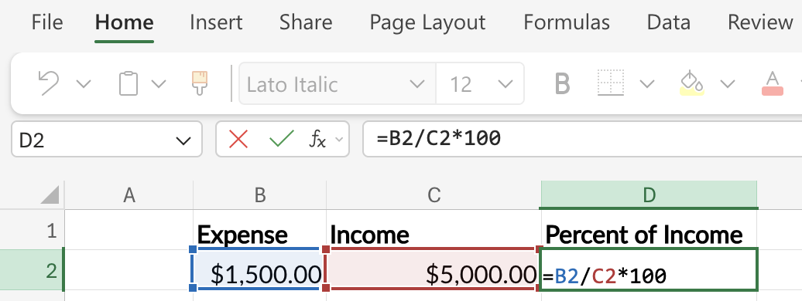
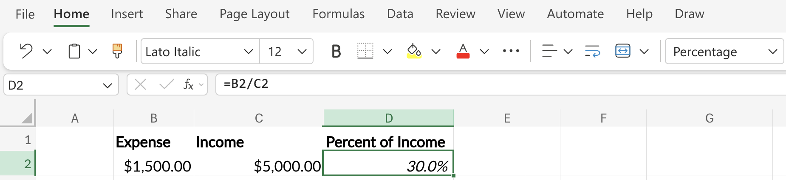
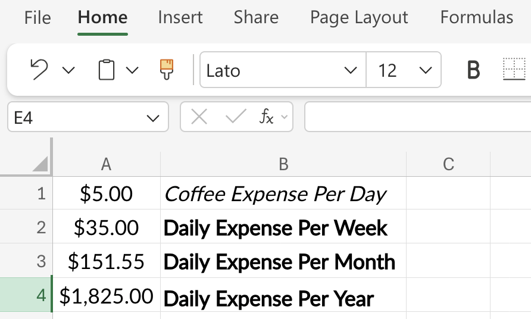
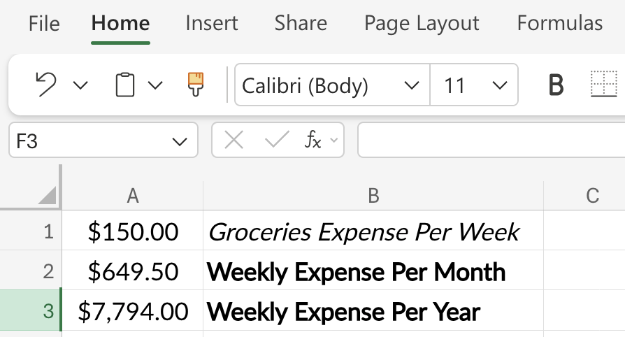
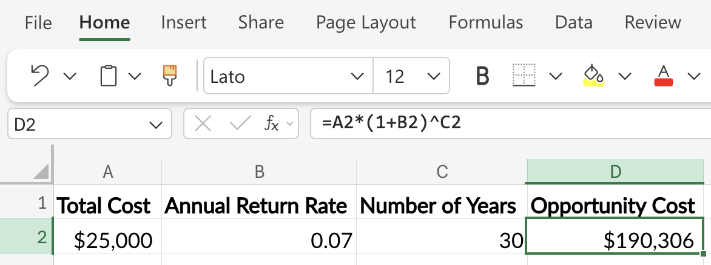
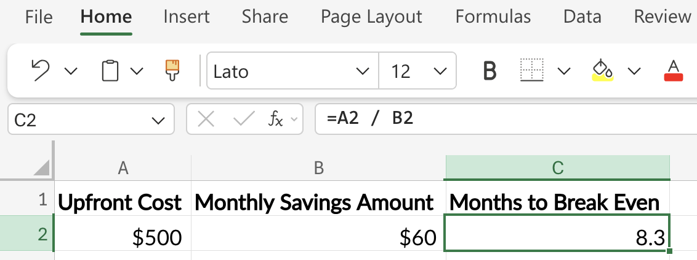

```{r}
#| label: setup-r
#| message: false
#| warning: false
#| include: false
source("_common.R")
```

```{python}
#| label: setup-py
#| include: false
```

## Book Topics

- **Mindset shift**: a budget is intentional allocation, not restriction; reframe "I have to spend" as "my needs cost"; room for error is the most underrated concept (Housel)
- **Expense categories**: fixed (lock in and automate), variable (category limits, not line by line tracking), periodic (set aside 1/12 of the annual cost each month)
- **Sinking funds**: $1,200/year car insurance becomes $100/month; gifts $600 → $50, car maintenance $1,200 → $100, vacation $2,400 → $200
- **Zero-based budgeting**: every dollar of a $5,000 paycheck gets a job and the remainder is $0; best for anyone rebuilding from debt or with irregular income
- **Percentage-based budgeting**: Sethi's Conscious Spending Plan (fixed 50 to 60%, investments 10%+, savings 5 to 10%, guilt-free 20 to 35%) next to the 50/30/20 rule
- **Recommendation**: zero-based for 2 to 3 months, then graduate to percentages with automation
- **Tools**: a spreadsheet with tabs for income, fixed, variable, sinking funds, net worth, and a summary; the best tool is the one you will actually use
- **Budgeting math**: percentages, annualizing and monthly-izing, opportunity cost, break-even
- **Financial Order of Operations**: the budget shows how much is left over; Preston's FOO shows where it goes next

## Percentages

The foundational budgeting calculation: what share of income does each expense represent? Picture income as one bar and each expense as a slice of it.

**Formula:** (Expense ÷ Income) × 100

Book example: rent of \$1,500 on \$5,000 of take-home pay is 30% of income.

```{r}
#| label: pct-bar-model
#| echo: false
#| fig-cap: "Rent ($1,500) as a share of a $5,000 paycheck"
#| fig-asp: 0.25
library(ggplot2)
df_pct <- data.frame(
  label  = c("Rent\n$1,500", "Remaining\n$3,500"),
  amount = c(1500, 3500)
)
ggplot(df_pct, aes(x = "", y = amount, fill = label)) +
  geom_col(width = 0.5) +
  geom_text(aes(label = label), position = position_stack(vjust = 0.5),
            colour = "white", fontface = "bold", size = 4) +
  coord_flip() +
  scale_fill_manual(values = c("Rent\n$1,500" = "#f44242",
                               "Remaining\n$3,500" = "#0e9aa7")) +
  scale_y_continuous(labels = function(x) paste0("$", format(x, big.mark = ","))) +
  labs(x = NULL, y = "Monthly income ($5,000)") +
  theme_minimal(base_size = 12) +
  theme(legend.position = "none", axis.text.y = element_blank(),
        axis.ticks.y = element_blank(), panel.grid = element_blank())
```

::: panel-tabset

## Excel

Assuming `Expense` is in cell `B2` and `Income` is in cell `C2`:

``` swift
=(B2 / C2) * 100
```

{width='100%' fig-align='center'}

Or, more simply, enter `=B2 / C2` and format the cell as a **Percentage** using the button in the toolbar.

{width='100%' fig-align='center'}

For the full zero-based budget, put category names in `A2:A8`, amounts in `B2:B8`, and income in `E1`. In `C2`, lock the income cell with `$` and fill down to `C8`:

``` swift
=B2 / $E$1
```

Check the totals in row 9. `B9` should equal income, and `C9` should read 100%:

``` swift
=SUM(B2:B8)
=SUM(C2:C8)
```

## Python

The Python version of `percent_of_income()` works the same way.

```{python}
#| label: percent-py
def percent_of_income(expense, income):
    return (expense / income) * 100

percent_of_income(expense=1500, income=5000)
```

Plain Python works one value at a time, so we loop over the zero-based budget from the book.

```{python}
#| label: percent-py-zero-based
zero_based = {
    "Rent": 1500, "Groceries": 500, "Transport": 300, "Investments": 1000,
    "Savings": 500, "Fun Money": 700, "Other": 500,
}
for category, amount in zero_based.items():
    print(f"{category:<12} ${amount:>6,}  {percent_of_income(amount, 5000):5.1f}%")
```

Sanity check: the dollars add up to income and the percentages add up to 100.

```{python}
#| label: percent-py-check
total = sum(zero_based.values())
print(total, percent_of_income(total, 5000))
```

How to read this: rent is 30% of take-home pay, and every category together uses 100%. If the total were above 100, the budget would spend more than you earn.

One edge case: Python raises a `ZeroDivisionError` when income is zero, so guard against it.

```{python}
#| label: percent-py-edge
def safe_percent_of_income(expense, income):
    if income == 0:
        return None
    return percent_of_income(expense, income)

print(safe_percent_of_income(1500, 0))
```

## R

`percent_of_income()` divides an expense by income and multiplies by 100.

```{r}
#| label: percent-r
percent_of_income <- function(expense, income) {
  (expense / income) * 100
}

percent_of_income(expense = 1500, income = 5000)
```

The function is vectorized, so we can pass the whole zero-based budget from the book at once.

```{r}
#| label: percent-r-zero-based
zero_based <- data.frame(
  category = c("Rent", "Groceries", "Transport", "Investments",
               "Savings", "Fun Money", "Other"),
  amount   = c(1500, 500, 300, 1000, 500, 700, 500)
)
zero_based$pct <- percent_of_income(zero_based$amount, income = 5000)
zero_based
```

Sanity check: in a zero-based budget, the dollars add up to income and the percentages add up to 100.

```{r}
#| label: percent-r-check
sum(zero_based$amount)
sum(zero_based$pct)
```

How to read this: rent is 30% of take-home pay, and every category together uses 100%. If the total were above 100, the budget would spend more than you earn.

One edge case: an income of zero has no meaningful percentage. R returns `Inf` (or `NaN` for 0 ÷ 0) instead of an error.

```{r}
#| label: percent-r-edge
percent_of_income(expense = 1500, income = 0)
```

:::

## Annualizing and Monthly-izing

Scale any spending habit across time periods to see the true cost. Each period is the shorter one multiplied by how many times it fits.

**Formula:** Cost over a longer period = Cost per period × Number of periods it contains

**Daily → Weekly:** × 7

**Weekly → Monthly:** × 4.33 (not 4)

**Monthly → Annual:** × 12

**Daily → Annual:** × 365

**Annual → Monthly:** ÷ 12

Book example: a \$5 daily coffee is \$5 × 365 = \$1,825 per year.

```{r}
#| label: annual-bar-model
#| echo: false
#| fig-cap: "The same $5/day habit across four time periods"
#| fig-asp: 0.50
library(ggplot2)
df_annual <- data.frame(
  period = factor(c("Daily\n($5)", "Weekly\n($35)", "Monthly\n($152)", "Annual\n($1,825)"),
                  levels = c("Daily\n($5)", "Weekly\n($35)", "Monthly\n($152)", "Annual\n($1,825)")),
  cost = c(5, 35, 152, 1825),
  fill = c("#86ddcd", "#0e9aa7", "#48a56a", "#f44242")
)
ggplot(df_annual, aes(x = period, y = cost, fill = period)) +
  geom_col(width = 0.6) +
  geom_text(aes(label = paste0("$", format(cost, big.mark = ","))),
            vjust = -0.4, fontface = "bold", size = 4) +
  scale_fill_manual(values = setNames(df_annual$fill, as.character(df_annual$period))) +
  scale_y_continuous(limits = c(0, 2100), labels = function(x) paste0("$", x)) +
  labs(x = NULL, y = NULL) +
  theme_minimal(base_size = 12) +
  theme(legend.position = "none", panel.grid.major.x = element_blank(),
        panel.grid.minor = element_blank())
```

::: panel-tabset

## Excel

Let's start with the daily value in cell `A1`, then convert it to the cost per week in cell `A2`:

``` swift
=A1 * 7
```

Next we can convert the week to the monthly cost in cell `A3`:

``` swift
=A2 * 4.33
```

Finally, we get the annual cost in cell `A4`:

``` swift
=A1 * 365
```

Format cells `A1` - `A4` as **Currency** or **Accounting**.

{width='100%' fig-align='center'}

To convert a weekly value in cell `A1` to a monthly value, place the following formula in cell `A2`:

``` swift
=A1 * 4.33
```

To convert the monthly cost to an annual cost, enter the following in cell `A3`:

``` swift
=A2 * 12
```

Format cells `A1` - `A3` as **Currency** or **Accounting**.

{width='100%' fig-align='center'}

For a sinking fund tab, put expense names in `A2:A5` and annual costs in `B2:B5`. In `C2`, enter the formula below and fill down, then total the column in `C6` with `=SUM(C2:C5)`:

``` swift
=B2 / 12
```

## Python

The Python versions use a dictionary of factors.

```{python}
#| label: annualize-py
def to_annual(amount, period="daily"):
    factors = {"daily": 365, "weekly": 52, "monthly": 12}
    return amount * factors[period]

def to_monthly(amount, period="daily"):
    factors = {"daily": 30.44, "weekly": 4.33, "annual": 1 / 12}
    return amount * factors[period]
```

The book examples: a \$5/day coffee over a year, and \$150/week on groceries over a month.

```{python}
#| label: annualize-py-apply
print(to_annual(amount=5, period="daily"))
print(to_monthly(amount=150, period="weekly"))
```

Several habits side by side.

```{python}
#| label: annualize-py-table
habits = [("Coffee", 5, "daily"), ("Groceries", 150, "weekly"), ("Streaming", 15.99, "monthly")]
for habit, amount, period in habits:
    annual = to_annual(amount, period)
    print(f"{habit:<10} annual ${annual:>9,.2f}  monthly ${annual / 12:>7,.2f}")
```

The same math powers sinking funds. Divide each periodic cost from the book by 12.

```{python}
#| label: sinking-fund-py
sinking = {"Car insurance": 1200, "Christmas/gifts": 600,
           "Car maintenance": 1200, "Annual vacation": 2400}
monthly = {k: to_monthly(v, period="annual") for k, v in sinking.items()}
for k, v in monthly.items():
    print(f"{k:<16} ${v:,.2f}/month")
print(f"Total: ${sum(monthly.values()):,.2f}/month")
```

Sanity check: 4.33 × 12 = 51.96 weeks, so the two routes differ by about \$6 on \$150/week.

```{python}
#| label: annualize-py-check
print(to_annual(150, "weekly"), round(to_monthly(150, "weekly") * 12, 2))
```

How to read this: the annual number is the one to compare against your goals. A \$5 habit you never think about costs about as much as a vacation.

## R

`to_annual()` multiplies a recurring amount by how many times it happens in a year. `to_monthly()` converts any period to a monthly amount.

```{r}
#| label: annualize-r
to_annual <- function(amount, period = c("daily", "weekly", "monthly")) {
  period  <- match.arg(period)
  factors <- c(daily = 365, weekly = 52, monthly = 12)
  amount * factors[[period]]
}

to_monthly <- function(amount, period = c("daily", "weekly", "annual")) {
  period  <- match.arg(period)
  factors <- c(daily = 30.44, weekly = 4.33, annual = 1 / 12)
  amount * factors[[period]]
}
```

The book examples: a \$5/day coffee over a year, and \$150/week on groceries over a month.

```{r}
#| label: annualize-r-apply
to_annual(amount = 5, period = "daily")
to_monthly(amount = 150, period = "weekly")
```

Several habits side by side. `mapply()` runs both functions over each row.

```{r}
#| label: annualize-r-table
habits <- data.frame(
  habit  = c("Coffee", "Groceries", "Streaming"),
  amount = c(5, 150, 15.99),
  period = c("daily", "weekly", "monthly")
)
habits$annual  <- mapply(to_annual, habits$amount, habits$period)
habits$monthly <- habits$annual / 12
habits
```

The same math powers sinking funds. Divide each periodic cost from the book by 12 to get the monthly set aside.

```{r}
#| label: sinking-fund-r
sinking <- data.frame(
  expense = c("Car insurance", "Christmas/gifts", "Car maintenance", "Annual vacation"),
  annual  = c(1200, 600, 1200, 2400)
)
sinking$monthly <- to_monthly(sinking$annual, period = "annual")
sinking
sum(sinking$monthly)
```

Sanity check: 4.33 weeks × 12 months is 51.96 weeks, a hair short of 52. That is why weekly → monthly → annual lands \$6 under weekly → annual for \$150/week.

```{r}
#| label: annualize-r-check
to_annual(150, "weekly")
to_monthly(150, "weekly") * 12
```

How to read this: the annual number is the one to compare against your goals. A \$5 habit you never think about costs about as much as a vacation.

:::

## Opportunity Cost

Every dollar spent is also what that dollar could have become. The hidden cost of any purchase is its future value if invested instead.

**Formula:** amount × (1 + r)\^n

Book example: choosing a \$15,000 used car over a \$40,000 new one and investing the \$25,000 difference at 7% for 30 years gives \$25,000 × (1.07)\^30 ≈ \$190,000.

```{r}
#| label: opp-cost-bar-model
#| echo: false
#| fig-cap: "$25,000 invested at 7%: value at each checkpoint"
#| fig-asp: 0.50
library(ggplot2)
yrs  <- c(0, 5, 10, 20, 30)
vals <- round(25000 * (1.07)^yrs)
df_opp <- data.frame(
  year  = factor(paste0("Year ", yrs), levels = paste0("Year ", yrs)),
  value = vals
)
ggplot(df_opp, aes(x = year, y = value)) +
  geom_col(fill = "#0e9aa7", width = 0.6) +
  geom_text(aes(label = paste0("$", formatC(value, format = "d", big.mark = ","))),
            vjust = -0.4, fontface = "bold", size = 3.5) +
  scale_y_continuous(limits = c(0, max(vals) * 1.18),
                     labels = function(x) paste0("$", round(x / 1000), "k")) +
  labs(x = NULL, y = NULL) +
  theme_minimal(base_size = 12) +
  theme(panel.grid.major.x = element_blank(), panel.grid.minor = element_blank())
```

::: panel-tabset

## Excel

Assuming the initial amount is in cell `A2`, the annual rate (as a decimal, e.g., 0.07) is in `B2`, and the number of years is in `C2`:

``` swift
=A2*(1+B2)^C2
```

{width='100%' fig-align='center'}

For a grid, put the amount in `A1`, rates across `B2:D2` (0.05, 0.07, 0.09), and years down `A3:A6` (5, 10, 20, 30). In `B3`, enter the formula below and fill right and down. The `$` signs keep the amount, the rate row, and the years column locked:

``` swift
=$A$1*(1+B$2)^$A3
```

## Python

The Python version of `opportunity_cost()` works the same way.

```{python}
#| label: opp-cost-py
def opportunity_cost(amount, rate, years):
    return amount * (1 + rate) ** years

opportunity_cost(amount=25000, rate=0.07, years=30)
```

A grid of horizons and rates. numpy broadcasting fills every combination at once.

```{python}
#| label: opp-cost-py-grid
import numpy as np

years = np.array([5, 10, 20, 30])
rates = np.array([0.05, 0.07, 0.09])
grid = opportunity_cost(25000, rates[None, :], years[:, None])
print("         " + "".join(f"{r:>10.0%}" for r in rates))
for y, row in zip(years, grid):
    print(f"{y:>2} yrs   " + "".join(f"{v:>10,.0f}" for v in row))
```

Sanity check: 0% growth or 0 years returns the original amount.

```{python}
#| label: opp-cost-py-check
print(opportunity_cost(25000, 0, 30), opportunity_cost(25000, 0.07, 0))
```

How to read this: the 7% column is the book's estimate, but even the 5% column shows the car choice is worth more than \$100,000 after 30 years. The longer the horizon, the more the rate matters.

## R

`opportunity_cost()` takes the dollar `amount`, the yearly `rate` of return, and the number of `years`.

```{r}
#| label: opp-cost-r
opportunity_cost <- function(amount, rate, years) {
  amount * (1 + rate)^years
}

opportunity_cost(amount = 25000, rate = 0.07, years = 30)
```

Returns are never guaranteed, so compare a cautious, middle, and hopeful rate across several horizons. `outer()` builds the whole grid in one call.

```{r}
#| label: opp-cost-r-grid
years <- c(5, 10, 20, 30)
rates <- c(0.05, 0.07, 0.09)
grid <- outer(years, rates, function(y, r) opportunity_cost(25000, r, y))
dimnames(grid) <- list(paste(years, "yrs"), paste0(rates * 100, "%"))
round(grid)
```

Sanity check: at 0% the money just sits there, and after 0 years nothing has grown.

```{r}
#| label: opp-cost-r-check
opportunity_cost(25000, rate = 0, years = 30)
opportunity_cost(25000, rate = 0.07, years = 0)
```

How to read this: the 7% column is the book's estimate, but even the 5% column shows the car choice is worth more than \$100,000 after 30 years. The longer the horizon, the more the rate matters.

:::

## Break-Even

Useful for evaluating memberships, subscriptions, refinances, or any purchase with an upfront cost and recurring savings. Break-even is the first month cumulative savings meets the upfront cost.

**Formula:** Upfront Cost ÷ Monthly Savings = months to break even

Book example: a \$500 membership that saves \$60/month breaks even in \$500 ÷ \$60 = 8.3 months.

```{r}
#| label: break-even-bar-model
#| echo: false
#| fig-cap: "$60/month savings accumulating toward a $500 upfront cost"
#| fig-asp: 0.50
library(ggplot2)
months <- 1:10
df_be  <- data.frame(month = factor(paste0("Mo ", months), levels = paste0("Mo ", months)),
                     saved = months * 60)
df_be$reached <- df_be$saved >= 500
ggplot(df_be, aes(x = month, y = saved, fill = reached)) +
  geom_col(width = 0.65) +
  geom_hline(yintercept = 500, colour = "#f44242", linewidth = 1, linetype = "dashed") +
  annotate("text", x = 5.5, y = 520, label = "Upfront cost: $500",
           colour = "#f44242", fontface = "bold", size = 3.5) +
  scale_fill_manual(values = c("FALSE" = "#0e9aa7", "TRUE" = "#48a56a")) +
  scale_y_continuous(labels = function(x) paste0("$", x)) +
  labs(x = NULL, y = "Cumulative savings") +
  theme_minimal(base_size = 12) +
  theme(legend.position = "none", panel.grid.major.x = element_blank(),
        panel.grid.minor = element_blank())
```

::: panel-tabset

## Excel

Assuming the upfront cost is in cell `A2` and the monthly savings amount is in cell `B2`:

``` swift
=A2 / B2
```

{width='100%' fig-align='center'}

To round up to whole months and flag purchases that never break even, use this in `C2` instead:

``` swift
=IF(B2 <= 0, "Never", ROUNDUP(A2 / B2, 0))
```

## Python

The Python version of `months_to_break_even()` works the same way.

```{python}
#| label: break-even-py
def months_to_break_even(upfront_cost, monthly_savings):
    return upfront_cost / monthly_savings

months_to_break_even(upfront_cost=500, monthly_savings=60)
```

Round up to the month you actually cross the line.

```{python}
#| label: break-even-py-ceiling
import math

math.ceil(months_to_break_even(500, 60))
```

Compare a few options at once.

```{python}
#| label: break-even-py-table
options = [("Gym membership", 500, 60), ("Warehouse club", 65, 15), ("Refinance fee", 3000, 120)]
for option, upfront, savings in options:
    m = months_to_break_even(upfront, savings)
    print(f"{option:<15} {m:5.1f} months  (month {math.ceil(m)})")
```

Edge case: zero savings raises a `ZeroDivisionError` in Python, and negative savings gives a negative answer. Neither ever breaks even, so guard against both.

```{python}
#| label: break-even-py-edge
def safe_break_even(upfront_cost, monthly_savings):
    if monthly_savings <= 0:
        return math.inf
    return months_to_break_even(upfront_cost, monthly_savings)

print(safe_break_even(500, 0), safe_break_even(500, -10))
```

How to read this: the \$500 membership pays for itself if you keep using it past month 9. If you are not sure you will last that long, skip it.

## R

`months_to_break_even()` divides the upfront cost by the monthly savings.

```{r}
#| label: break-even-r
months_to_break_even <- function(upfront_cost, monthly_savings) {
  upfront_cost / monthly_savings
}

months_to_break_even(upfront_cost = 500, monthly_savings = 60)
```

Savings arrive in whole months, so round up to find the month you actually cross the line. That matches the first green bar in the chart.

```{r}
#| label: break-even-r-ceiling
ceiling(months_to_break_even(500, 60))
```

Compare a few options at once.

```{r}
#| label: break-even-r-table
options_df <- data.frame(
  option  = c("Gym membership", "Warehouse club", "Refinance fee"),
  upfront = c(500, 65, 3000),
  savings = c(60, 15, 120)
)
options_df$months <- months_to_break_even(options_df$upfront, options_df$savings)
options_df$whole_months <- ceiling(options_df$months)
options_df
```

Edge case: if a purchase saves nothing (or costs more each month), it never breaks even. Check before dividing.

```{r}
#| label: break-even-r-edge
months_to_break_even(500, 0)
months_to_break_even(500, -10)
```

How to read this: the \$500 membership pays for itself if you keep using it past month 9. If you are not sure you will last that long, skip it.

:::
