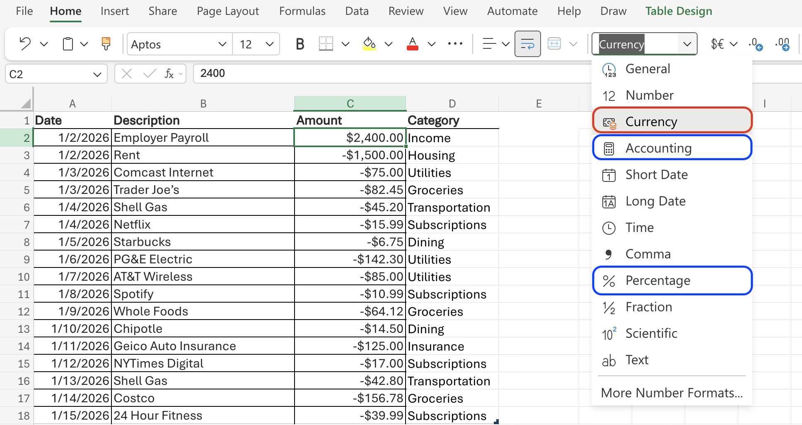



```{r}
#| label: setup-r
#| message: false
#| warning: false
#| include: false
source("_common.R")
```

```{python}
#| label: setup-py
#| include: false
```

::: {.callout-tip}
## How these exercises work

Each topic starts with a real scenario and a bar model, then three levels of exercises. **Level 1 (Guided)** fills in the blanks of a finished function. **Level 2 (Practice)** applies it to new numbers. **Level 3 (Challenge)** asks a new question with little scaffolding. The R and Python exercises run in your browser: click **Run Code** to try, **Submit Answer** to check, and use the hint or solution if you get stuck. Excel exercises have a solution you can reveal.
:::

## Book Topics

- **Take-home pay**: your salary (gross pay) is not what lands in your account; taxes, Social Security and Medicare (7.65%), 401(k), and health plans come out first, so plan around take-home pay
- **Wealth vs. spending**: true wealth is the income you *didn't* spend, quietly compounding (Housel); conspicuous consumption is negatively correlated with actual wealth (Felix)
- **Human capital**: early in a career, future earning potential is the biggest asset; invest in skills and career growth, and take more stock market risk when young (Felix)
- **Spending and happiness**: experiences beat possessions; buying time is a high return use of money; lifestyle inflation is the silent killer; housing is the biggest lever
- **Three anchoring rules**: spend on what you love, cut what you don't (Sethi); build a gap between ego and income (Housel); keep it simple (Bogle)
- **Wealth formula**: *Wealth = Focus + (Stoicism × Time × Diversification)*; focus is additive, the other three multiply, so a zero on any one collapses the second term (Galloway)
- **As income grows**: split every raise, 50% to investing and 50% to lifestyle
- **Math**: the wealth formula as yearly savings compounding ($62,400 income, 15% saved, 8% for 40 years), the fixed-cost ratio ($1,760 of $3,200 take-home pay, under a 60% ceiling), and what a raise is really worth ($200/month at 7% for 25 years)

## Writing Functions

Functions perform operations: calculate a total, build a table, create a graph. The function's *arguments* are the inputs it needs to do its job and the *output* is what it gives back. For example, `sum()` takes a list of numbers as input and outputs their total.

In R, functions are defined with the `function()` keyword and assigned to a name. The body goes inside curly braces.

``` r
my_fun <- function(x) {
  x * 2
}
```

In Python, functions are defined with `def`, followed by a colon and an indented body. An explicit `return` statement is required; without it the function returns `None`.

``` python
def my_fun(x):
    return x * 2
```

Both languages let you create reusable functions for financial calculations. The key difference is that R automatically returns the last evaluated expression while Python requires `return`.

## Number Formatting

Before working through the math, it helps to have two small formatting utilities that handle the `$` and `%` symbols seen throughout the book. They take a plain number and return a reader-friendly string.

::: panel-tabset
## Excel

In Excel, number formatting is applied through the toolbar. Select the cells to format and choose the appropriate option from the Number Format dropdown.

{width='100%' fig-align="center"}

There are two options for money: Currency and Accounting.[^excel-formats]

[^excel-formats]: Read more about the [differences between Currency and Accounting](https://support.microsoft.com/en-us/excel/format-numbers-as-currency-in-excel#__toc305071612) formats in Excel.

## Python

`fmt_dollar()` uses an [f-string](https://docs.python.org/3/tutorial/inputoutput.html#formatted-string-literals) with `,` for thousands and `.{digits}f` for decimal places.

```{python}
#| label: fmt-dollar-py
def fmt_dollar(x, digits=2):
    return f"${x:,.{digits}f}"
```

`fmt_pct()` takes a decimal rate, multiplies by 100, and formats the result.

```{python}
#| label: fmt-pct-py
def fmt_pct(x, digits=1):
    return f"{x * 100:.{digits}f}%"
```

Utility functions like `fmt_pct()` can be re-used in other, more complex functions. 

```{python}
#| label: fmt-utils-py-apply
print(fmt_dollar(9200))
print(fmt_dollar(4200.50))
print(fmt_pct(0.07))
print(fmt_pct(0.456))
```

## R

`fmt_dollar()` adds a dollar sign, comma separators, and rounds to a set number of decimal places.

```{r}
#| label: fmt-dollar-r
fmt_dollar <- function(x, digits = 2) {
  paste0("$", formatC(x, format = "f", digits = digits, big.mark = ","))
}
```

`fmt_pct()` expects a decimal rate (e.g. `0.07` for 7%) and converts it to a percentage string.

```{r}
#| label: fmt-pct-r
fmt_pct <- function(x, digits = 1) {
  paste0(round(x * 100, digits), "%")
}
```

This can be used to format percentages as strings with a percent sign.

```{r}
#| label: fmt-utils-r-apply
fmt_dollar(9200)
fmt_dollar(4200.50)
fmt_pct(0.07)
fmt_pct(0.456)
```

:::

Both `fmt_dollar()` and `fmt_pct()` follow the same convention: input is always a plain number, output is always a string. They are used throughout the remaining sections to clean up results.

## The Wealth Formula

Galloway's formula becomes real numbers when we picture someone earning \$62,400 a year (about the 2025 median for full time workers). They save 15% (\$9,360) every year and earn 8%. Each bar below is their savings at a checkpoint, split into what they put in and what it grew into.

**Formula:** Wealth after *n* years = Yearly savings × [((1 + r)\^n − 1) ÷ r]

Yearly savings = Income × Savings rate, *r* is the yearly return, and *n* is the number of years.

```{r}
#| label: wealth-bar-model
#| echo: false
#| fig-cap: "$9,360 saved every year at 8%: money put in vs. growth"
#| fig-asp: 0.50
library(ggplot2)
yrs <- c(10, 20, 30, 40)
put_in <- 9360 * yrs
total  <- 9360 * ((1.08^yrs - 1) / 0.08)
df_w <- data.frame(
  year   = factor(rep(paste0("Year ", yrs), 2), levels = paste0("Year ", yrs)),
  layer  = factor(rep(c("Growth", "Money put in"), each = 4),
                  levels = c("Growth", "Money put in")),
  amount = c(total - put_in, put_in)
)
ggplot(df_w, aes(x = year, y = amount, fill = layer)) +
  geom_col(width = 0.6, colour = "#1C1C1E", linewidth = 0.4) +
  geom_text(
    data = data.frame(year = factor(paste0("Year ", yrs), levels = paste0("Year ", yrs)), total = total),
    aes(x = year, y = total,
        label = paste0("$", formatC(round(total / 1000), format = "d", big.mark = ","), "k")),
    inherit.aes = FALSE, vjust = -0.4, fontface = "bold", size = 3.5
  ) +
  scale_fill_manual(values = c("Money put in" = "#0e9aa7", "Growth" = "#48a56a")) +
  scale_y_continuous(
    limits = c(0, max(total) * 1.12),
    labels = function(x) paste0("$", formatC(round(x / 1000), format = "d", big.mark = ","), "k")
  ) +
  labs(x = NULL, y = NULL, fill = NULL) +
  theme_minimal(base_size = 12) +
  theme(
    legend.position    = "top",
    panel.grid.major.x = element_blank(),
    panel.grid.minor   = element_blank()
  )
```

The blue layer grows in a straight line, one \$9,360 deposit per year. The green layer is growth, and it passes the blue layer after about year 18.

### Level 1: Guided

Fill in the blanks to finish `wealth_formula()`, then find the wealth after 40 years: \$62,400 income, 15% saved, 8% return.

::: panel-tabset

#### Excel

Put the inputs in `A2` (62400), `B2` (0.15), `C2` (0.08), and `D2` (40). In `E2`, write a formula for total wealth (money put in plus growth).

::: {.callout-note collapse="true"}
## Solution

```swift
=(A2*B2)*(((1+C2)^D2-1)/C2)
```

Or use `=FV(C2, D2, -A2*B2)`. Both return \$2,424,769.
:::

#### Python

```{pyodide}
#| exercise: wealth_1_py
def wealth_formula(median_income, savings_rate, annual_return, years):
    annual_savings = median_income * ______
    return annual_savings * (((1 + ______) ** years - 1) / annual_return)

wealth_formula(62400, 0.15, 0.08, 40)
```

::: {.hint exercise="wealth_1_py"}
Yearly savings is income times the savings rate. The growth factor uses the yearly return.
:::

::: {.solution exercise="wealth_1_py"}
```python
def wealth_formula(median_income, savings_rate, annual_return, years):
    annual_savings = median_income * savings_rate
    return annual_savings * (((1 + annual_return) ** years - 1) / annual_return)

wealth_formula(62400, 0.15, 0.08, 40)
```
:::

```{pyodide}
#| exercise: wealth_1_py
#| check: true
if result is not None and abs(result - 2424769.02) < 1:
    feedback = {"correct": True, "message": "Right: about $2.4 million after 40 years."}
else:
    feedback = {"correct": False, "message": "Not quite. Check which argument goes in each blank."}
feedback
```

#### R

```{webr}
#| exercise: wealth_1_r
wealth_formula <- function(median_income, savings_rate, annual_return, years) {
  annual_savings <- median_income * ______
  annual_savings * (((1 + ______)^years - 1) / annual_return)
}
wealth_formula(62400, 0.15, 0.08, 40)
```

::: {.hint exercise="wealth_1_r"}
Yearly savings is income times the savings rate. The growth factor uses the yearly return.
:::

::: {.solution exercise="wealth_1_r"}
```r
wealth_formula <- function(median_income, savings_rate, annual_return, years) {
  annual_savings <- median_income * savings_rate
  annual_savings * (((1 + annual_return)^years - 1) / annual_return)
}
wealth_formula(62400, 0.15, 0.08, 40)
```
:::

```{webr}
#| exercise: wealth_1_r
#| check: true
if (isTRUE(all.equal(.result, 2424769.02, tolerance = 1e-6))) {
  list(correct = TRUE, message = "Right: about $2.4 million after 40 years.")
} else {
  list(correct = FALSE, message = "Not quite. Check which argument goes in each blank.")
}
```

:::

### Level 2: Practice

Same \$62,400 income, but now you save 20% for 30 years at 8%. How much of the total is growth (total minus money put in)?

::: panel-tabset

#### Excel

Change `B2` to 0.20 and `D2` to 30. In `F2`, find the growth.

::: {.callout-note collapse="true"}
## Solution

```swift
=FV(C2, D2, -A2*B2) - A2*B2*D2
```

Growth is \$1,039,374 of the \$1,413,774 total.
:::

#### Python

```{pyodide}
#| exercise: wealth_2_py
#| setup: true
def wealth_formula(median_income, savings_rate, annual_return, years):
    annual_savings = median_income * savings_rate
    return annual_savings * (((1 + annual_return) ** years - 1) / annual_return)
```

```{pyodide}
#| exercise: wealth_2_py
total = wealth_formula(______)
put_in = ______
total - put_in
```

::: {.hint exercise="wealth_2_py"}
Money put in is yearly savings (income × rate) times the number of years.
:::

::: {.solution exercise="wealth_2_py"}
```python
total = wealth_formula(62400, 0.20, 0.08, 30)
put_in = 62400 * 0.20 * 30
total - put_in
```
:::

```{pyodide}
#| exercise: wealth_2_py
#| check: true
if result is not None and abs(result - 1039374.47) < 1:
    feedback = {"correct": True, "message": "Right: growth is about $1.04 million of the $1.41 million total."}
else:
    feedback = {"correct": False, "message": "Not quite. Did you subtract the money put in from the total?"}
feedback
```

#### R

```{webr}
#| exercise: wealth_2_r
#| setup: true
wealth_formula <- function(median_income, savings_rate, annual_return, years) {
  annual_savings <- median_income * savings_rate
  annual_savings * (((1 + annual_return)^years - 1) / annual_return)
}
```

```{webr}
#| exercise: wealth_2_r
total <- wealth_formula(______)
put_in <- ______
total - put_in
```

::: {.hint exercise="wealth_2_r"}
Money put in is yearly savings (income × rate) times the number of years.
:::

::: {.solution exercise="wealth_2_r"}
```r
total <- wealth_formula(62400, 0.20, 0.08, 30)
put_in <- 62400 * 0.20 * 30
total - put_in
```
:::

```{webr}
#| exercise: wealth_2_r
#| check: true
if (isTRUE(all.equal(.result, 1039374.47, tolerance = 1e-6))) {
  list(correct = TRUE, message = "Right: growth is about $1.04 million of the $1.41 million total.")
} else {
  list(correct = FALSE, message = "Not quite. Did you subtract the money put in from the total?")
}
```

:::

### Level 3: Challenge

Back to 15% saved at 8%. In which year does growth first become bigger than the money put in?

::: panel-tabset

#### Excel

Put years 1 to 40 in `A5:A44`. Build columns for total wealth, money put in, and growth, then find the first year where growth is bigger.

::: {.callout-note collapse="true"}
## Solution

In `B5`, `C5`, and `D5`, then fill down to row 44:

```swift
=FV($C$2, A5, -$A$2*$B$2)
=$A$2*$B$2*A5
=B5-C5
```

Then find the first year:

```swift
=MATCH(TRUE, D5:D44>C5:C44, 0)
```

The answer is year 18.
:::

#### Python

```{pyodide}
#| exercise: wealth_3_py
#| setup: true
def wealth_formula(median_income, savings_rate, annual_return, years):
    annual_savings = median_income * savings_rate
    return annual_savings * (((1 + annual_return) ** years - 1) / annual_return)
```

```{pyodide}
#| exercise: wealth_3_py
first_year = None
# loop over years 1 to 40 and stop at the first year growth beats money put in

first_year
```

::: {.hint exercise="wealth_3_py"}
Use `for years in range(1, 41):`, compute `total` and `put_in`, and `break` when `total - put_in > put_in`.
:::

::: {.solution exercise="wealth_3_py"}
```python
first_year = None
for years in range(1, 41):
    total = wealth_formula(62400, 0.15, 0.08, years)
    put_in = 62400 * 0.15 * years
    if total - put_in > put_in:
        first_year = years
        break

first_year
```
:::

```{pyodide}
#| exercise: wealth_3_py
#| check: true
if result == 18:
    feedback = {"correct": True, "message": "Right: year 18. From then on, growth does more work than you do."}
else:
    feedback = {"correct": False, "message": "Not quite. Compare growth (total minus put in) to money put in."}
feedback
```

#### R

```{webr}
#| exercise: wealth_3_r
#| setup: true
wealth_formula <- function(median_income, savings_rate, annual_return, years) {
  annual_savings <- median_income * savings_rate
  annual_savings * (((1 + annual_return)^years - 1) / annual_return)
}
```

```{webr}
#| exercise: wealth_3_r
years <- 1:40
# find the first year growth beats money put in

```

::: {.hint exercise="wealth_3_r"}
`wealth_formula()` is vectorized, so pass all 40 years at once. Then use `min(years[...])` with a comparison inside the brackets.
:::

::: {.solution exercise="wealth_3_r"}
```r
years <- 1:40
total <- wealth_formula(62400, 0.15, 0.08, years)
put_in <- 62400 * 0.15 * years
min(years[total - put_in > put_in])
```
:::

```{webr}
#| exercise: wealth_3_r
#| check: true
if (isTRUE(all.equal(as.numeric(.result), 18))) {
  list(correct = TRUE, message = "Right: year 18. From then on, growth does more work than you do.")
} else {
  list(correct = FALSE, message = "Not quite. Compare growth (total minus put in) to money put in.")
}
```

:::

## Fixed-Cost Ratio

Fixed costs (rent, loan payments, insurance, utilities) are the bills you can't easily change month to month. Picture a first job with \$3,200 of take-home pay a month and \$1,760 of fixed costs. The bar below cuts that paycheck into 10 equal pieces of \$320 (each piece is 10%).

**Formula:** Fixed-Cost Ratio = Fixed Costs ÷ Take-Home Pay × 100

```{r}
#| label: fixed-cost-bar-model
#| echo: false
#| fig-cap: "$3,200 take-home pay in 10 units of $320: fixed costs vs. flexible spending"
#| fig-asp: 0.30
library(ggplot2)
parts <- c("Fixed costs ($1,760)", "Flexible spending ($1,440)")
df_fc <- data.frame(
  part   = factor(parts, levels = rev(parts)),
  amount = c(1760, 1440),
  bar    = "Take-home pay"
)
ggplot(df_fc, aes(x = amount, y = bar, fill = part)) +
  geom_col(width = 0.5, colour = "#1C1C1E", linewidth = 0.4) +
  geom_vline(xintercept = seq(320, 2880, by = 320), colour = "white", linewidth = 0.5) +
  geom_vline(xintercept = 1920, colour = "#1C1C1E", linetype = "dashed", linewidth = 1) +
  annotate("text", x = 1920, y = 1.42, label = "60% ceiling: $1,920",
           fontface = "bold", size = 3.4, hjust = -0.05) +
  scale_fill_manual(values = c("Fixed costs ($1,760)" = "#f44242",
                               "Flexible spending ($1,440)" = "#86ddcd"),
                    breaks = parts) +
  scale_x_continuous(breaks = seq(0, 3200, by = 640),
                     labels = function(x) paste0("$", formatC(x, format = "d", big.mark = ","))) +
  scale_y_discrete(expand = expansion(add = c(0.4, 0.6))) +
  labs(x = NULL, y = NULL, fill = NULL) +
  theme_minimal(base_size = 12) +
  theme(
    legend.position    = "top",
    panel.grid.major.y = element_blank(),
    panel.grid.minor   = element_blank(),
    axis.text.y        = element_blank()
  )
```

The red section covers 5 and a half of the 10 pieces, so fixed costs take 55% of the paycheck. The ceiling is 60% of \$3,200, or \$1,920.

### Level 1: Guided

Fill in the blanks to finish `fixed_cost_ratio()`, then find the ratio for \$1,760 of fixed costs on \$3,200 take-home pay.

::: panel-tabset

#### Excel

Enter fixed costs in `A2` (1760) and take-home pay in `B2` (3200). In `C2`, write the ratio as a number out of 100.

::: {.callout-note collapse="true"}
## Solution

```swift
=A2/B2*100
```

This returns 55. Or enter `=A2/B2` and format the cell as a percentage.
:::

#### Python

```{pyodide}
#| exercise: fixed_1_py
def fixed_cost_ratio(fixed_costs, take_home):
    return (______ / ______) * 100

fixed_cost_ratio(1760, 3200)
```

::: {.hint exercise="fixed_1_py"}
The ratio is the part (fixed costs) divided by the whole (take-home pay).
:::

::: {.solution exercise="fixed_1_py"}
```python
def fixed_cost_ratio(fixed_costs, take_home):
    return (fixed_costs / take_home) * 100

fixed_cost_ratio(1760, 3200)
```
:::

```{pyodide}
#| exercise: fixed_1_py
#| check: true
if result is not None and abs(result - 55) < 0.01:
    feedback = {"correct": True, "message": "Right: 55%, under the 60% ceiling."}
else:
    feedback = {"correct": False, "message": "Not quite. Divide fixed costs by take-home pay."}
feedback
```

#### R

```{webr}
#| exercise: fixed_1_r
fixed_cost_ratio <- function(fixed_costs, take_home) {
  (______ / ______) * 100
}
fixed_cost_ratio(1760, 3200)
```

::: {.hint exercise="fixed_1_r"}
The ratio is the part (fixed costs) divided by the whole (take-home pay).
:::

::: {.solution exercise="fixed_1_r"}
```r
fixed_cost_ratio <- function(fixed_costs, take_home) {
  (fixed_costs / take_home) * 100
}
fixed_cost_ratio(1760, 3200)
```
:::

```{webr}
#| exercise: fixed_1_r
#| check: true
if (isTRUE(all.equal(.result, 55))) {
  list(correct = TRUE, message = "Right: 55%, under the 60% ceiling.")
} else {
  list(correct = FALSE, message = "Not quite. Divide fixed costs by take-home pay.")
}
```

:::

### Level 2: Practice

A job with lower pay brings home \$2,800 a month, with the same \$1,760 of fixed costs. How much room is left under the 60% ceiling? (A negative answer means you are over.)

::: panel-tabset

#### Excel

Change `B2` to 2800. In `D2`, find the room left under the ceiling.

::: {.callout-note collapse="true"}
## Solution

```swift
=B2*0.6-A2
```

This returns -80: the same fixed costs are \$80 over the line on a smaller paycheck.
:::

#### Python

```{pyodide}
#| exercise: fixed_2_py
take_home = 2800
fixed_costs = 1760
ceiling_60 = ______
ceiling_60 - fixed_costs
```

::: {.hint exercise="fixed_2_py"}
The ceiling is 60% of take-home pay.
:::

::: {.solution exercise="fixed_2_py"}
```python
take_home = 2800
fixed_costs = 1760
ceiling_60 = take_home * 0.60
ceiling_60 - fixed_costs
```
:::

```{pyodide}
#| exercise: fixed_2_py
#| check: true
if result is not None and abs(result - (-80)) < 0.01:
    feedback = {"correct": True, "message": "Right: $80 over the line. Same rent, smaller paycheck."}
else:
    feedback = {"correct": False, "message": "Not quite. Multiply take-home pay by 0.60, then subtract fixed costs."}
feedback
```

#### R

```{webr}
#| exercise: fixed_2_r
take_home <- 2800
fixed_costs <- 1760
ceiling_60 <- ______
ceiling_60 - fixed_costs
```

::: {.hint exercise="fixed_2_r"}
The ceiling is 60% of take-home pay.
:::

::: {.solution exercise="fixed_2_r"}
```r
take_home <- 2800
fixed_costs <- 1760
ceiling_60 <- take_home * 0.60
ceiling_60 - fixed_costs
```
:::

```{webr}
#| exercise: fixed_2_r
#| check: true
if (isTRUE(all.equal(.result, -80))) {
  list(correct = TRUE, message = "Right: $80 over the line. Same rent, smaller paycheck.")
} else {
  list(correct = FALSE, message = "Not quite. Multiply take-home pay by 0.60, then subtract fixed costs.")
}
```

:::

### Level 3: Challenge

You bring home \$3,200 a month, and your fixed costs other than rent (insurance, phone, loan payment) add up to \$560. Write `max_fixed_costs(take_home, ceiling)` that returns the most you can spend on fixed costs, then use it to find the highest rent that keeps you under 60%.

::: panel-tabset

#### Excel

With take-home pay in `B2` (3200), find the highest rent in one formula.

::: {.callout-note collapse="true"}
## Solution

```swift
=B2*0.6-560
```

The highest rent is \$1,360.
:::

#### Python

```{pyodide}
#| exercise: fixed_3_py
def max_fixed_costs(take_home, ceiling=0.60):
    # your code here
    pass

max_fixed_costs(3200) - 560
```

::: {.hint exercise="fixed_3_py"}
The function only needs one line: take-home pay times the ceiling.
:::

::: {.solution exercise="fixed_3_py"}
```python
def max_fixed_costs(take_home, ceiling=0.60):
    return take_home * ceiling

max_fixed_costs(3200) - 560
```
:::

```{pyodide}
#| exercise: fixed_3_py
#| check: true
if result is not None and abs(result - 1360) < 0.01:
    feedback = {"correct": True, "message": "Right: rent up to $1,360 keeps you at 60%."}
else:
    feedback = {"correct": False, "message": "Not quite. Return take_home * ceiling, then subtract the other fixed costs."}
feedback
```

#### R

```{webr}
#| exercise: fixed_3_r
max_fixed_costs <- function(take_home, ceiling = 0.60) {
  # your code here
}
max_fixed_costs(3200) - 560
```

::: {.hint exercise="fixed_3_r"}
The function only needs one line: take-home pay times the ceiling.
:::

::: {.solution exercise="fixed_3_r"}
```r
max_fixed_costs <- function(take_home, ceiling = 0.60) {
  take_home * ceiling
}
max_fixed_costs(3200) - 560
```
:::

```{webr}
#| exercise: fixed_3_r
#| check: true
if (isTRUE(all.equal(.result, 1360))) {
  list(correct = TRUE, message = "Right: rent up to $1,360 keeps you at 60%.")
} else {
  list(correct = FALSE, message = "Not quite. Return take_home * ceiling, then subtract the other fixed costs.")
}
```

:::

## Using Pipes in R

```{r}
#| label: fixed-cost-r
#| include: false
fixed_cost_ratio <- function(fixed_costs, take_home) {
  (fixed_costs / take_home) * 100
}
```

```{python}
#| label: fixed-cost-py
#| include: false
def fixed_cost_ratio(fixed_costs, take_home):
    return (fixed_costs / take_home) * 100
```

The pipe operator (`|>`) passes the output of one function directly into the next function as its first argument, so the code reads left to right instead of inside out. `fixed_cost_ratio()` already multiplies by 100, so we can pipe its result into `round()` and then `paste0()` to add the percent sign.

``` r
fixed_cost_ratio(fixed_costs = 1760, take_home = 3200) |> round(1) |> paste0("%")
```

Read that as: compute the ratio, *then* round it, *then* add the `%`. The version without a pipe nests the calls and reads from the inside out, which is harder to follow.

``` r
paste0(round(fixed_cost_ratio(fixed_costs = 1760, take_home = 3200), 1), "%")
```

When steps always belong together, wrap them in a single function so callers only see one name.

```{r}
#| label: fixed-cost-pct-r
#| code-fold: false
fixed_cost_pct <- function(fixed_costs, take_home) {
  fixed_cost_ratio(fixed_costs, take_home) |>
    round(1) |>
    paste0("%")
}
```

```{r}
#| label: fixed-cost-pct-r-apply
#| code-fold: false
fixed_cost_pct(fixed_costs = 1760, take_home = 3200)
```

Python has no native pipe operator. The equivalent is storing the result from `fixed_cost_ratio()` in a variable and passing it to the next step:

```{python}
#| label: fixed-cost-pct-py
#| code-fold: false
def fixed_cost_pct(fixed_costs, take_home):
    ratio = fixed_cost_ratio(fixed_costs, take_home)
    return f"{ratio:.1f}%"
```

```{python}
#| label: fixed-cost-pct-py-apply
#| code-fold: false
fixed_cost_pct(fixed_costs=1760, take_home=3200)
```

Python's approach emphasizes explicit intermediate steps. This reads top to bottom and makes debugging easier since you can inspect `ratio` along the way.

Read more about the pipe operator in [R vs. Python](r_vs_py.qmd#sec-pipe-operator).

### Exercise: Pipes

Rewrite the nested call below with the pipe so it reads left to right. Use the pricier apartment: \$2,160 of fixed costs on \$3,200.

```{webr}
#| exercise: pipes_r
#| setup: true
fixed_cost_ratio <- function(fixed_costs, take_home) {
  (fixed_costs / take_home) * 100
}
```

```{webr}
#| exercise: pipes_r
# nested: paste0(round(fixed_cost_ratio(2160, 3200), 1), "%")
fixed_cost_ratio(2160, 3200) |> ______ |> ______
```

::: {.hint exercise="pipes_r"}
Each step after the pipe takes the previous result as its first argument: `round(1)`, then `paste0("%")`.
:::

::: {.solution exercise="pipes_r"}
```r
fixed_cost_ratio(2160, 3200) |> round(1) |> paste0("%")
```
:::

```{webr}
#| exercise: pipes_r
#| check: true
if (identical(.result, "67.5%")) {
  list(correct = TRUE, message = "Right: 67.5%, over the 60% line.")
} else {
  list(correct = FALSE, message = "Not quite. Round to 1 digit, then paste on the percent sign.")
}
```

## What a Raise Is Really Worth

Say a raise adds \$400 a month to your take-home pay, and you split it: \$200 goes to your lifestyle and \$200 gets invested. The chart shows what that single habit produces at 7% over 25 years.

**Formula:** FV = PMT × [((1 + r)\^n − 1) ÷ r]

PMT is the amount invested each month, *r* is the monthly return (7% ÷ 12), and *n* is the number of months (25 × 12 = 300).

```{r}
#| label: raise-value-bar-model
#| echo: false
#| fig-cap: "$200/month invested at 7%: value at each 5-year checkpoint"
#| fig-asp: 0.50
library(ggplot2)
yrs  <- c(5, 10, 15, 20, 25)
vals <- round(200 * (((1 + 0.07 / 12)^(yrs * 12) - 1) / (0.07 / 12)))
df_raise <- data.frame(
  year  = factor(paste0("Year ", yrs), levels = paste0("Year ", yrs)),
  value = vals
)
df_layers <- data.frame(
  year   = rep(df_raise$year, 2),
  layer  = factor(rep(c("Growth", "Money put in"), each = length(yrs)),
                  levels = c("Growth", "Money put in")),
  amount = c(vals - 200 * 12 * yrs, 200 * 12 * yrs)
)
ggplot(df_raise, aes(x = year, y = value)) +
  geom_col(data = df_layers, aes(x = year, y = amount, fill = layer),
           width = 0.6, colour = "#1C1C1E", linewidth = 0.4, inherit.aes = FALSE) +
  scale_fill_manual(values = c("Money put in" = "#0e9aa7", "Growth" = "#48a56a")) +
  geom_text(
    aes(label = paste0("$", formatC(round(value / 1000), format = "d",
                                    big.mark = ","), "k")),
    vjust = -0.4, fontface = "bold", size = 3.5
  ) +
  scale_y_continuous(
    limits = c(0, max(vals) * 1.2),
    labels = function(x) paste0("$", round(x / 1000), "k")
  ) +
  labs(x = NULL, y = NULL, fill = NULL,
       subtitle = "$200/month invested at 7% annual return") +
  theme_minimal(base_size = 12) +
  theme(
    legend.position    = "top",
    panel.grid.major.x = element_blank(),
    panel.grid.minor   = element_blank()
  )
```

### Level 1: Guided

Fill in the blanks to finish `raise_invested_value()`, then find the value of investing half of a \$400 raise for 25 years at 7%.

::: panel-tabset

#### Excel

Use the built in `FV(rate, nper, pmt)` function with a monthly rate, a number of months, and the monthly contribution as a negative number.

::: {.callout-note collapse="true"}
## Solution

```swift
=FV(7%/12, 25*12, -200)
```

This returns \$162,014.34.
:::

#### Python

```{pyodide}
#| exercise: raise_1_py
def raise_invested_value(monthly_raise, invest_share, rate, years):
    contribution = monthly_raise * ______
    monthly_rate = rate / ______
    periods = years * 12
    return contribution * (((1 + monthly_rate) ** periods - 1) / monthly_rate)

raise_invested_value(400, 0.5, 0.07, 25)
```

::: {.hint exercise="raise_1_py"}
The contribution is the share of the raise you invest. The yearly rate is split across 12 months.
:::

::: {.solution exercise="raise_1_py"}
```python
def raise_invested_value(monthly_raise, invest_share, rate, years):
    contribution = monthly_raise * invest_share
    monthly_rate = rate / 12
    periods = years * 12
    return contribution * (((1 + monthly_rate) ** periods - 1) / monthly_rate)

raise_invested_value(400, 0.5, 0.07, 25)
```
:::

```{pyodide}
#| exercise: raise_1_py
#| check: true
if result is not None and abs(result - 162014.34) < 1:
    feedback = {"correct": True, "message": "Right: about $162,000 from $200 a month."}
else:
    feedback = {"correct": False, "message": "Not quite. Check the share and the number of months in a year."}
feedback
```

#### R

```{webr}
#| exercise: raise_1_r
raise_invested_value <- function(monthly_raise, invest_share, rate, years) {
  contribution <- monthly_raise * ______
  monthly_rate <- rate / ______
  periods      <- years * 12
  contribution * (((1 + monthly_rate)^periods - 1) / monthly_rate)
}
raise_invested_value(400, 0.5, 0.07, 25)
```

::: {.hint exercise="raise_1_r"}
The contribution is the share of the raise you invest. The yearly rate is split across 12 months.
:::

::: {.solution exercise="raise_1_r"}
```r
raise_invested_value <- function(monthly_raise, invest_share, rate, years) {
  contribution <- monthly_raise * invest_share
  monthly_rate <- rate / 12
  periods      <- years * 12
  contribution * (((1 + monthly_rate)^periods - 1) / monthly_rate)
}
raise_invested_value(400, 0.5, 0.07, 25)
```
:::

```{webr}
#| exercise: raise_1_r
#| check: true
if (isTRUE(all.equal(.result, 162014.34, tolerance = 1e-6))) {
  list(correct = TRUE, message = "Right: about $162,000 from $200 a month.")
} else {
  list(correct = FALSE, message = "Not quite. Check the share and the number of months in a year.")
}
```

:::

### Level 2: Practice

Now invest 75% of the same \$400 raise for 25 years at 7%. How much of the final value is growth?

::: panel-tabset

#### Excel

Find the growth in one formula: the future value minus the money put in.

::: {.callout-note collapse="true"}
## Solution

```swift
=FV(7%/12, 25*12, -300) - 300*25*12
```

Growth is \$153,022 of the \$243,022 total.
:::

#### Python

```{pyodide}
#| exercise: raise_2_py
#| setup: true
def raise_invested_value(monthly_raise, invest_share, rate, years):
    contribution = monthly_raise * invest_share
    monthly_rate = rate / 12
    periods = years * 12
    return contribution * (((1 + monthly_rate) ** periods - 1) / monthly_rate)
```

```{pyodide}
#| exercise: raise_2_py
value = raise_invested_value(______)
put_in = ______
value - put_in
```

::: {.hint exercise="raise_2_py"}
75% of \$400 is \$300 a month, for 25 × 12 months.
:::

::: {.solution exercise="raise_2_py"}
```python
value = raise_invested_value(400, 0.75, 0.07, 25)
put_in = 400 * 0.75 * 25 * 12
value - put_in
```
:::

```{pyodide}
#| exercise: raise_2_py
#| check: true
if result is not None and abs(result - 153021.51) < 1:
    feedback = {"correct": True, "message": "Right: about $153,000 of growth on $90,000 put in."}
else:
    feedback = {"correct": False, "message": "Not quite. Money put in is $300 a month for 300 months."}
feedback
```

#### R

```{webr}
#| exercise: raise_2_r
#| setup: true
raise_invested_value <- function(monthly_raise, invest_share, rate, years) {
  contribution <- monthly_raise * invest_share
  monthly_rate <- rate / 12
  periods      <- years * 12
  contribution * (((1 + monthly_rate)^periods - 1) / monthly_rate)
}
```

```{webr}
#| exercise: raise_2_r
value <- raise_invested_value(______)
put_in <- ______
value - put_in
```

::: {.hint exercise="raise_2_r"}
75% of \$400 is \$300 a month, for 25 × 12 months.
:::

::: {.solution exercise="raise_2_r"}
```r
value <- raise_invested_value(400, 0.75, 0.07, 25)
put_in <- 400 * 0.75 * 25 * 12
value - put_in
```
:::

```{webr}
#| exercise: raise_2_r
#| check: true
if (isTRUE(all.equal(.result, 153021.51, tolerance = 1e-6))) {
  list(correct = TRUE, message = "Right: about $153,000 of growth on $90,000 put in.")
} else {
  list(correct = FALSE, message = "Not quite. Money put in is $300 a month for 300 months.")
}
```

:::

### Level 3: Challenge

You invest half of a \$400 raise at 7%. How many whole years until it is worth at least \$100,000?

::: panel-tabset

#### Excel

Put years 1 to 30 in `A2:A31`. Find the value at each year, then find the first year at or above \$100,000.

::: {.callout-note collapse="true"}
## Solution

In `B2`, then fill down to row 31:

```swift
=FV(7%/12, A2*12, -200)
```

Then:

```swift
=MATCH(TRUE, B2:B31>=100000, 0)
```

The answer is 20 years.
:::

#### Python

```{pyodide}
#| exercise: raise_3_py
#| setup: true
def raise_invested_value(monthly_raise, invest_share, rate, years):
    contribution = monthly_raise * invest_share
    monthly_rate = rate / 12
    periods = years * 12
    return contribution * (((1 + monthly_rate) ** periods - 1) / monthly_rate)
```

```{pyodide}
#| exercise: raise_3_py
years = 1
# keep adding a year until the value reaches $100,000

years
```

::: {.hint exercise="raise_3_py"}
Use `while raise_invested_value(400, 0.5, 0.07, years) < 100000:` and add 1 to `years` inside the loop.
:::

::: {.solution exercise="raise_3_py"}
```python
years = 1
while raise_invested_value(400, 0.5, 0.07, years) < 100000:
    years += 1

years
```
:::

```{pyodide}
#| exercise: raise_3_py
#| check: true
if result == 20:
    feedback = {"correct": True, "message": "Right: 20 years turns $200 a month into $100,000."}
else:
    feedback = {"correct": False, "message": "Not quite. Stop at the first year the value is at least $100,000."}
feedback
```

#### R

```{webr}
#| exercise: raise_3_r
#| setup: true
raise_invested_value <- function(monthly_raise, invest_share, rate, years) {
  contribution <- monthly_raise * invest_share
  monthly_rate <- rate / 12
  periods      <- years * 12
  contribution * (((1 + monthly_rate)^periods - 1) / monthly_rate)
}
```

```{webr}
#| exercise: raise_3_r
years <- 1:30
# find the first year the value is at least $100,000

```

::: {.hint exercise="raise_3_r"}
`raise_invested_value()` is vectorized, so pass all 30 years at once. Then use `min(years[...])`.
:::

::: {.solution exercise="raise_3_r"}
```r
years <- 1:30
value <- raise_invested_value(400, 0.5, 0.07, years)
min(years[value >= 100000])
```
:::

```{webr}
#| exercise: raise_3_r
#| check: true
if (isTRUE(all.equal(as.numeric(.result), 20))) {
  list(correct = TRUE, message = "Right: 20 years turns $200 a month into $100,000.")
} else {
  list(correct = FALSE, message = "Not quite. Stop at the first year the value is at least $100,000.")
}
```

:::
