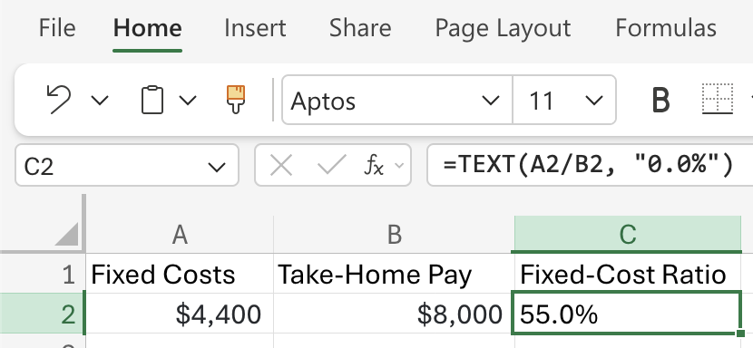
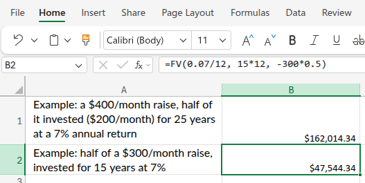

```{r}
#| label: setup-r
#| message: false
#| warning: false
#| include: false
source("_common.R")
```

```{python}
#| label: setup-py
#| include: false
```

## Book Topics

- **Take-home pay**: your salary (gross pay) is not what lands in your account; taxes, Social Security and Medicare (7.65%), 401(k), and health plans come out first, so plan around take-home pay
- **Wealth vs. spending**: true wealth is the income you *didn't* spend, quietly compounding (Housel); conspicuous consumption is negatively correlated with actual wealth (Felix)
- **Human capital**: early in a career, future earning potential is the biggest asset; invest in skills and career growth, and take more stock market risk when young (Felix)
- **Spending and happiness**: experiences beat possessions; buying time is a high return use of money; lifestyle inflation is the silent killer; housing is the biggest lever
- **Three anchoring rules**: spend on what you love, cut what you don't (Sethi); build a gap between ego and income (Housel); keep it simple (Bogle)
- **Wealth formula**: *Wealth = Focus + (Stoicism × Time × Diversification)*; focus is additive, the other three multiply, so a zero on any one collapses the second term (Galloway)
- **As income grows**: split every raise, 50% to investing and 50% to lifestyle
- **Math**: the wealth formula as yearly savings compounding ($62,400 income, 15% saved, 8% for 40 years), the fixed-cost ratio ($1,760 of $3,200 take-home pay, under a 60% ceiling), and what a raise is really worth ($200/month at 7% for 25 years)

## Writing Functions

Functions perform operations: calculate a total, build a table, create a graph. The function's *arguments* are the inputs it needs to do its job and the *output* is what it gives back. For example, `sum()` takes a list of numbers as input and outputs their total.

In R, functions are defined with the `function()` keyword and assigned to a name. The body goes inside curly braces.

``` r
my_fun <- function(x) {
  x * 2
}
```

In Python, functions are defined with `def`, followed by a colon and an indented body. An explicit `return` statement is required; without it the function returns `None`.

``` python
def my_fun(x):
    return x * 2
```

Both languages let you create reusable functions for financial calculations. The key difference is that R automatically returns the last evaluated expression while Python requires `return`.

## Number Formatting

Before working through the math, it helps to have two small formatting utilities that handle the `$` and `%` symbols seen throughout the book. They take a plain number and return a reader-friendly string.

::: panel-tabset
## R

`fmt_dollar()` adds a dollar sign, comma separators, and rounds to a set number of decimal places.

```{r}
#| label: fmt-dollar-r
fmt_dollar <- function(x, digits = 2) {
  paste0("$", formatC(x, format = "f", digits = digits, big.mark = ","))
}
```

`fmt_pct()` expects a decimal rate (e.g. `0.07` for 7%) and converts it to a percentage string.

```{r}
#| label: fmt-pct-r
fmt_pct <- function(x, digits = 1) {
  paste0(round(x * 100, digits), "%")
}
```

This can be used to format percentages as strings with a percent sign.

```{r}
#| label: fmt-utils-r-apply
fmt_dollar(9200)
fmt_dollar(4200.50)
fmt_pct(0.07)
fmt_pct(0.456)
```

## Python

`fmt_dollar()` uses an [f-string](https://docs.python.org/3/tutorial/inputoutput.html#formatted-string-literals) with `,` for thousands and `.{digits}f` for decimal places.

```{python}
#| label: fmt-dollar-py
def fmt_dollar(x, digits=2):
    return f"${x:,.{digits}f}"
```

`fmt_pct()` takes a decimal rate, multiplies by 100, and formats the result.

```{python}
#| label: fmt-pct-py
def fmt_pct(x, digits=1):
    return f"{x * 100:.{digits}f}%"
```

Utility functions like `fmt_pct()` can be re-used in other, more complex functions. 

```{python}
#| label: fmt-utils-py-apply
print(fmt_dollar(9200))
print(fmt_dollar(4200.50))
print(fmt_pct(0.07))
print(fmt_pct(0.456))
```

## Excel

In Excel, number formatting is applied through the toolbar. Select the cells to format and choose the appropriate option from the Number Format dropdown.

{width='100%' fig-align="center"}

There are two options for money: Currency and Accounting.[^excel-formats]

[^excel-formats]: Read more about the [differences between Currency and Accounting](https://support.microsoft.com/en-us/excel/format-numbers-as-currency-in-excel#__toc305071612) formats in Excel.

:::

Both `fmt_dollar()` and `fmt_pct()` follow the same convention: input is always a plain number, output is always a string. They are used throughout the remaining sections to clean up results.

## The Wealth Formula

Galloway's formula becomes real numbers when we picture someone earning \$62,400 a year (about the 2025 median for full time workers). They save 15% (\$9,360) every year and earn 8%. Each bar below is their savings at a checkpoint, split into what they put in and what it grew into.

**Formula:** Wealth after *n* years = Yearly savings × [((1 + r)\^n − 1) ÷ r]

Yearly savings = Income × Savings rate, *r* is the yearly return, and *n* is the number of years.

```{r}
#| label: wealth-bar-model
#| echo: false
#| fig-cap: "$9,360 saved every year at 8%: money put in vs. growth"
#| fig-asp: 0.50
library(ggplot2)
yrs <- c(10, 20, 30, 40)
put_in <- 9360 * yrs
total  <- 9360 * ((1.08^yrs - 1) / 0.08)
df_w <- data.frame(
  year   = factor(rep(paste0("Year ", yrs), 2), levels = paste0("Year ", yrs)),
  layer  = factor(rep(c("Growth", "Money put in"), each = 4),
                  levels = c("Growth", "Money put in")),
  amount = c(total - put_in, put_in)
)
ggplot(df_w, aes(x = year, y = amount, fill = layer)) +
  geom_col(width = 0.6, colour = "#1C1C1E", linewidth = 0.4) +
  geom_text(
    data = data.frame(year = factor(paste0("Year ", yrs), levels = paste0("Year ", yrs)), total = total),
    aes(x = year, y = total,
        label = paste0("$", formatC(round(total / 1000), format = "d", big.mark = ","), "k")),
    inherit.aes = FALSE, vjust = -0.4, fontface = "bold", size = 3.5
  ) +
  scale_fill_manual(values = c("Money put in" = "#0e9aa7", "Growth" = "#48a56a")) +
  scale_y_continuous(
    limits = c(0, max(total) * 1.12),
    labels = function(x) paste0("$", formatC(round(x / 1000), format = "d", big.mark = ","), "k")
  ) +
  labs(x = NULL, y = NULL, fill = NULL) +
  theme_minimal(base_size = 12) +
  theme(
    legend.position    = "top",
    panel.grid.major.x = element_blank(),
    panel.grid.minor   = element_blank()
  )
```

The blue layer grows in a straight line, one \$9,360 deposit per year. The green layer is growth, and it passes the blue layer after about year 18.

::: panel-tabset

## R

`wealth_formula()` returns the future value of saving a fixed amount every year.

```{r}
#| label: wealth-formula-r
wealth_formula <- function(median_income, savings_rate, annual_return, years) {
  # future value of saving a fixed amount every year (contributions plus growth)
  annual_savings <- median_income * savings_rate
  annual_savings * (((1 + annual_return)^years - 1) / annual_return)
}
```

After 40 years with median income, a 15% savings rate, and an 8% return:

```{r}
#| label: wealth-formula-r-apply
wealth_formula(
  median_income = 62400,
  savings_rate = 0.15,
  annual_return = 0.08,
  years = 40
) |> fmt_dollar()
```

The function is vectorized, so we can pass several checkpoints at once and split each total into money put in and growth:

```{r}
#| label: wealth-formula-r-checkpoints
yrs <- c(10, 18, 20, 30, 40)
total <- wealth_formula(62400, 0.15, 0.08, yrs)
put_in <- 62400 * 0.15 * yrs
data.frame(
  years  = yrs,
  put_in = fmt_dollar(put_in, 0),
  growth = fmt_dollar(total - put_in, 0),
  total  = fmt_dollar(total, 0)
)
```

Year 18 is the first checkpoint where growth is bigger than the money put in.

Stoicism is the savings rate. Here is the same income at three savings rates after 40 years:

```{r}
#| label: wealth-formula-r-rates
rates <- c(0.10, 0.15, 0.20)
data.frame(
  savings_rate = fmt_pct(rates),
  yearly       = fmt_dollar(62400 * rates, 0),
  after_40     = fmt_dollar(wealth_formula(62400, rates, 0.08, 40), 0)
)
```

Two edge cases are worth checking. A savings rate of zero collapses the whole term to zero, just like Galloway's formula says. A return of exactly zero divides by zero, so R returns `NaN`; with no growth the answer is simply yearly savings × years.

```{r}
#| label: wealth-formula-r-edge
wealth_formula(62400, savings_rate = 0, annual_return = 0.08, years = 40)
wealth_formula(62400, savings_rate = 0.15, annual_return = 0, years = 40)
62400 * 0.15 * 40
```

How to read this result: about \$2.4 million after 40 years, and only \$374,400 of it is money you put in. Time and growth did the rest.

## Python

The Python version of `wealth_formula()` works the same way:

```{python}
#| label: wealth-formula-py
def wealth_formula(median_income, savings_rate, annual_return, years):
    # future value of saving a fixed amount every year (contributions plus growth)
    annual_savings = median_income * savings_rate
    return annual_savings * (((1 + annual_return)**years - 1) / annual_return)
```

After 40 years with median income, a 15% savings rate, and an 8% return:

```{python}
#| label: wealth-formula-py-apply
fmt_dollar(wealth_formula(
    median_income=62400,
    savings_rate=0.15,
    annual_return=0.08,
    years=40
))
```

Plain Python numbers are not vectorized, so we loop over the checkpoints:

```{python}
#| label: wealth-formula-py-checkpoints
for yrs in [10, 18, 20, 30, 40]:
    total = wealth_formula(62400, 0.15, 0.08, yrs)
    put_in = 62400 * 0.15 * yrs
    print(f"{yrs:>3} yrs  put in {fmt_dollar(put_in, 0):>10}  "
          f"growth {fmt_dollar(total - put_in, 0):>11}  total {fmt_dollar(total, 0):>11}")
```

The same income at three savings rates after 40 years:

```{python}
#| label: wealth-formula-py-rates
for rate in [0.10, 0.15, 0.20]:
    print(f"{fmt_pct(rate):>6}  {fmt_dollar(62400 * rate, 0):>8}/yr  "
          f"{fmt_dollar(wealth_formula(62400, rate, 0.08, 40), 0):>12}")
```

A savings rate of zero returns zero. A return of exactly zero raises a `ZeroDivisionError` in Python (R returns `NaN` instead), so with no growth use yearly savings × years:

```{python}
#| label: wealth-formula-py-edge
print(wealth_formula(62400, savings_rate=0, annual_return=0.08, years=40))
try:
    wealth_formula(62400, savings_rate=0.15, annual_return=0, years=40)
except ZeroDivisionError:
    print("No growth:", fmt_dollar(62400 * 0.15 * 40))
```

## Excel

Put the inputs in one row:

* `A2`: median income (62400)
* `B2`: savings rate (0.15)
* `C2`: annual return (0.08)
* `D2`: years (40)

Total contributed (the money put in) in `E2`:

```swift
=A2*B2*D2
```

Total wealth, contributions plus growth, in `F2`:

```swift
=(A2*B2)*(((1+C2)^D2-1)/C2)
```

Excel's built in `FV()` gives the same \$2,424,769 (enter the yearly savings as a negative number because it is cash leaving your pocket):

```swift
=FV(C2, D2, -A2*B2)
```

Growth alone in `G2`:

```swift
=F2-E2
```

`F2` already includes everything in `E2`, so don't add the two together. To compare savings rates, fill `B3:B4` with 0.10 and 0.20 and copy the row down.

:::

## Fixed-Cost Ratio

Fixed costs (rent, loan payments, insurance, utilities) are the bills you can't easily change month to month. Picture a first job with \$3,200 of take-home pay a month and \$1,760 of fixed costs. The bar below cuts that paycheck into 10 equal pieces of \$320 (each piece is 10%).

**Formula:** Fixed-Cost Ratio = Fixed Costs ÷ Take-Home Pay × 100

```{r}
#| label: fixed-cost-bar-model
#| echo: false
#| fig-cap: "$3,200 take-home pay in 10 units of $320: fixed costs vs. flexible spending"
#| fig-asp: 0.30
library(ggplot2)
parts <- c("Fixed costs ($1,760)", "Flexible spending ($1,440)")
df_fc <- data.frame(
  part   = factor(parts, levels = rev(parts)),
  amount = c(1760, 1440),
  bar    = "Take-home pay"
)
ggplot(df_fc, aes(x = amount, y = bar, fill = part)) +
  geom_col(width = 0.5, colour = "#1C1C1E", linewidth = 0.4) +
  geom_vline(xintercept = seq(320, 2880, by = 320), colour = "white", linewidth = 0.5) +
  geom_vline(xintercept = 1920, colour = "#1C1C1E", linetype = "dashed", linewidth = 1) +
  annotate("text", x = 1920, y = 1.42, label = "60% ceiling: $1,920",
           fontface = "bold", size = 3.4, hjust = -0.05) +
  scale_fill_manual(values = c("Fixed costs ($1,760)" = "#f44242",
                               "Flexible spending ($1,440)" = "#86ddcd"),
                    breaks = parts) +
  scale_x_continuous(breaks = seq(0, 3200, by = 640),
                     labels = function(x) paste0("$", formatC(x, format = "d", big.mark = ","))) +
  scale_y_discrete(expand = expansion(add = c(0.4, 0.6))) +
  labs(x = NULL, y = NULL, fill = NULL) +
  theme_minimal(base_size = 12) +
  theme(
    legend.position    = "top",
    panel.grid.major.y = element_blank(),
    panel.grid.minor   = element_blank(),
    axis.text.y        = element_blank()
  )
```

The red section covers 5 and a half of the 10 pieces, so fixed costs take 55% of the paycheck. The ceiling is 60% of \$3,200, or \$1,920.

::: panel-tabset

## R

```{r}
#| label: fixed-cost-r
fixed_cost_ratio <- function(fixed_costs, take_home) {
  (fixed_costs / take_home) * 100
}
```

\$1,760 of fixed costs on \$3,200 take-home pay:

```{r}
#| label: fixed-cost-r-apply
fixed_cost_ratio(fixed_costs = 1760, take_home = 3200)
```

How much room is left under the 60% ceiling?

```{r}
#| label: fixed-cost-r-room
ceiling_60 <- 3200 * 0.60
ceiling_60
ceiling_60 - 1760
```

The ratio works on several budgets at once. Below, the same \$1,760 of fixed costs is compared against three paychecks, plus a higher rent on the original paycheck:

```{r}
#| label: fixed-cost-r-compare
budgets <- data.frame(
  scenario    = c("First job", "Lower pay", "After a raise", "Pricier apartment"),
  fixed_costs = c(1760, 1760, 1760, 2160),
  take_home   = c(3200, 2800, 3600, 3200)
)
budgets$ratio    <- round(fixed_cost_ratio(budgets$fixed_costs, budgets$take_home), 1)
budgets$under_60 <- budgets$ratio <= 60
budgets
```

How to read this result: anything at or under 60 leaves at least 40% of the paycheck for savings and flexible spending. A \$400 jump in rent pushes the same paycheck to 67.5%, over the line.

## Python

```{python}
#| label: fixed-cost-py
def fixed_cost_ratio(fixed_costs, take_home):
    return (fixed_costs / take_home) * 100
```

\$1,760 of fixed costs on \$3,200 take-home pay:

```{python}
#| label: fixed-cost-py-apply
fixed_cost_ratio(fixed_costs=1760, take_home=3200)
```

Python prints `55.00000000000001` because computers store decimals in binary, which adds a tiny rounding error. Wrap the result in `round()` for display:

```{python}
#| label: fixed-cost-py-round
round(fixed_cost_ratio(fixed_costs=1760, take_home=3200), 1)
```

Room left under the 60% ceiling:

```{python}
#| label: fixed-cost-py-room
ceiling_60 = 3200 * 0.60
print(fmt_dollar(ceiling_60), fmt_dollar(ceiling_60 - 1760))
```

The same comparison across four budgets:

```{python}
#| label: fixed-cost-py-compare
budgets = [
    ("First job", 1760, 3200),
    ("Lower pay", 1760, 2800),
    ("After a raise", 1760, 3600),
    ("Pricier apartment", 2160, 3200),
]
for scenario, fixed, pay in budgets:
    ratio = fixed_cost_ratio(fixed, pay)
    print(f"{scenario:<18} {ratio:5.1f}  under 60: {ratio <= 60}")
```

## Excel

Enter fixed costs in `A2` (1760) and take-home pay in `B2` (3200), then in `C2`:

```swift
=A2/B2*100
```

That gives `55`. Or enter `=A2/B2` and format `C2` as a percentage (`Home → %`) to display 55%. For a percent string:

```swift
=TEXT(A2/B2, "0.0%")
```

{width="75%"}

The room left under the 60% ceiling, in `D2`:

```swift
=B2*0.6-A2
```

A pass/fail flag in `E2`:

```swift
=IF(A2/B2<=0.6, "Under 60%", "Over 60%")
```

Add more budgets in rows 3 to 5 and fill `C2:E2` down.

:::

## Using Pipes in R

The pipe operator (`|>`) passes the output of one function directly into the next function as its first argument, so the code reads left to right instead of inside out. `fixed_cost_ratio()` already multiplies by 100, so we can pipe its result into `round()` and then `paste0()` to add the percent sign.

``` r
fixed_cost_ratio(fixed_costs = 1760, take_home = 3200) |> round(1) |> paste0("%")
```

Read that as: compute the ratio, *then* round it, *then* add the `%`. The version without a pipe nests the calls and reads from the inside out, which is harder to follow.

``` r
paste0(round(fixed_cost_ratio(fixed_costs = 1760, take_home = 3200), 1), "%")
```

When steps always belong together, wrap them in a single function so callers only see one name.

```{r}
#| label: fixed-cost-pct-r
#| code-fold: false
fixed_cost_pct <- function(fixed_costs, take_home) {
  fixed_cost_ratio(fixed_costs, take_home) |>
    round(1) |>
    paste0("%")
}
```

```{r}
#| label: fixed-cost-pct-r-apply
#| code-fold: false
fixed_cost_pct(fixed_costs = 1760, take_home = 3200)
```

Python has no native pipe operator. The equivalent is storing the result from `fixed_cost_ratio()` in a variable and passing it to the next step:

```{python}
#| label: fixed-cost-pct-py
#| code-fold: false
def fixed_cost_pct(fixed_costs, take_home):
    ratio = fixed_cost_ratio(fixed_costs, take_home)
    return f"{ratio:.1f}%"
```

```{python}
#| label: fixed-cost-pct-py-apply
#| code-fold: false
fixed_cost_pct(fixed_costs=1760, take_home=3200)
```

Python's approach emphasizes explicit intermediate steps. This reads top to bottom and makes debugging easier since you can inspect `ratio` along the way.

Read more about the pipe operator in [R vs. Python](r_vs_py.qmd#sec-pipe-operator).

## What a Raise Is Really Worth

Say a raise adds \$400 a month to your take-home pay, and you split it: \$200 goes to your lifestyle and \$200 gets invested. The chart shows what that single habit produces at 7% over 25 years.

**Formula:** FV = PMT × [((1 + r)\^n − 1) ÷ r]

PMT is the amount invested each month, *r* is the monthly return (7% ÷ 12), and *n* is the number of months (25 × 12 = 300).

```{r}
#| label: raise-value-bar-model
#| echo: false
#| fig-cap: "$200/month invested at 7%: value at each 5-year checkpoint"
#| fig-asp: 0.50
library(ggplot2)
yrs  <- c(5, 10, 15, 20, 25)
vals <- round(200 * (((1 + 0.07 / 12)^(yrs * 12) - 1) / (0.07 / 12)))
df_raise <- data.frame(
  year  = factor(paste0("Year ", yrs), levels = paste0("Year ", yrs)),
  value = vals
)
df_layers <- data.frame(
  year   = rep(df_raise$year, 2),
  layer  = factor(rep(c("Growth", "Money put in"), each = length(yrs)),
                  levels = c("Growth", "Money put in")),
  amount = c(vals - 200 * 12 * yrs, 200 * 12 * yrs)
)
ggplot(df_raise, aes(x = year, y = value)) +
  geom_col(data = df_layers, aes(x = year, y = amount, fill = layer),
           width = 0.6, colour = "#1C1C1E", linewidth = 0.4, inherit.aes = FALSE) +
  scale_fill_manual(values = c("Money put in" = "#0e9aa7", "Growth" = "#48a56a")) +
  geom_text(
    aes(label = paste0("$", formatC(round(value / 1000), format = "d",
                                    big.mark = ","), "k")),
    vjust = -0.4, fontface = "bold", size = 3.5
  ) +
  scale_y_continuous(
    limits = c(0, max(vals) * 1.2),
    labels = function(x) paste0("$", round(x / 1000), "k")
  ) +
  labs(x = NULL, y = NULL, fill = NULL,
       subtitle = "$200/month invested at 7% annual return") +
  theme_minimal(base_size = 12) +
  theme(
    legend.position    = "top",
    panel.grid.major.x = element_blank(),
    panel.grid.minor   = element_blank()
  )
```

::: panel-tabset

## R

```{r}
#| label: raise-value-r
raise_invested_value <- function(monthly_raise, invest_share, rate, years) {
  contribution <- monthly_raise * invest_share
  monthly_rate <- rate / 12
  periods      <- years * 12
  contribution * (((1 + monthly_rate)^periods - 1) / monthly_rate)
}
```

Half of a \$400/month raise, invested for 25 years at 7%:

```{r}
#| label: raise-value-r-apply
raise_invested_value(
  monthly_raise = 400,
  invest_share = 0.5,
  rate = 0.07,
  years = 25) |> fmt_dollar()
```

Sanity check: you put in \$200 × 300 months = \$60,000, so growth added about \$102,000.

```{r}
#| label: raise-value-r-check
fv <- raise_invested_value(400, 0.5, 0.07, 25)
put_in <- 200 * 25 * 12
c(put_in = put_in, growth = round(fv - put_in))
```

How big a share should you invest? Here is the same \$400 raise split four ways, over 25 years:

```{r}
#| label: raise-value-r-shares
shares <- c(0.25, 0.50, 0.75, 1.00)
data.frame(
  invest_share = fmt_pct(shares, 0),
  monthly      = fmt_dollar(400 * shares, 0),
  after_25     = fmt_dollar(raise_invested_value(400, shares, 0.07, 25), 0)
)
```

How to read this result: every extra \$100 a month you invest adds about \$81,000 after 25 years. Even the 25% split grows to more than \$80,000.

## Python

```{python}
#| label: raise-value-py
def raise_invested_value(monthly_raise, invest_share, rate, years):
    contribution = monthly_raise * invest_share
    monthly_rate = rate / 12
    periods = years * 12
    return contribution * (((1 + monthly_rate) ** periods - 1) / monthly_rate)
```

Half of a \$400/month raise, invested for 25 years at 7%:

```{python}
#| label: raise-value-py-apply
fmt_dollar(raise_invested_value(monthly_raise=400, invest_share=0.5, rate=0.07, years=25))
```

Sanity check on money put in vs. growth:

```{python}
#| label: raise-value-py-check
fv = raise_invested_value(400, 0.5, 0.07, 25)
put_in = 200 * 25 * 12
print(fmt_dollar(put_in, 0), fmt_dollar(fv - put_in, 0))
```

The same \$400 raise split four ways:

```{python}
#| label: raise-value-py-shares
for share in [0.25, 0.50, 0.75, 1.00]:
    print(f"{fmt_pct(share, 0):>5}  {fmt_dollar(400 * share, 0):>5}/mo  "
          f"{fmt_dollar(raise_invested_value(400, share, 0.07, 25), 0):>9}")
```

## Excel

Use the built in `FV()` function: `FV(rate, nper, pmt)`.

* `rate`: monthly return = `7%/12`
* `nper`: number of months = `25*12`
* `pmt`: monthly contribution as a negative = `-200`

```swift
=FV(7%/12, 25*12, -200)
```

{width="75%" fig-align="center"}

This returns \$162,014.34. To compare splits, put the raise in `A2` (400), the share in `B2` (0.5), the yearly rate in `C2` (0.07), and the years in `D2` (25), then in `E2`:

```swift
=FV(C2/12, D2*12, -A2*B2)
```

Fill rows 3 to 5 with shares of 0.25, 0.75, and 1, and copy `E2` down. Money put in, in `F2`:

```swift
=A2*B2*D2*12
```

:::
