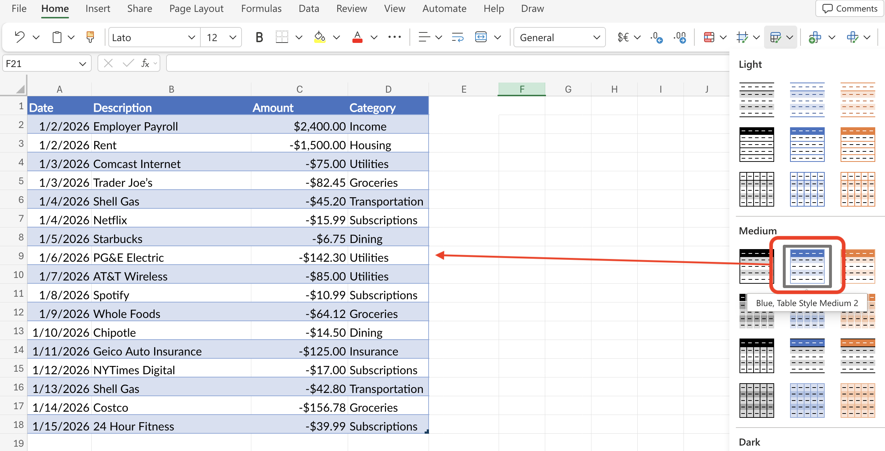
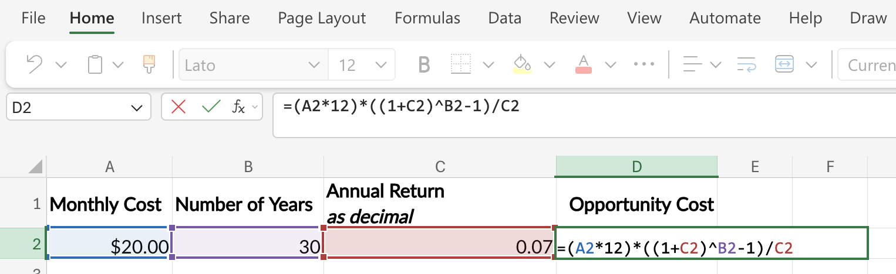
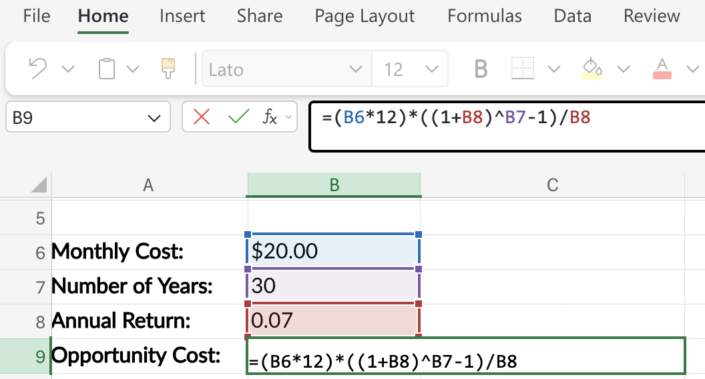
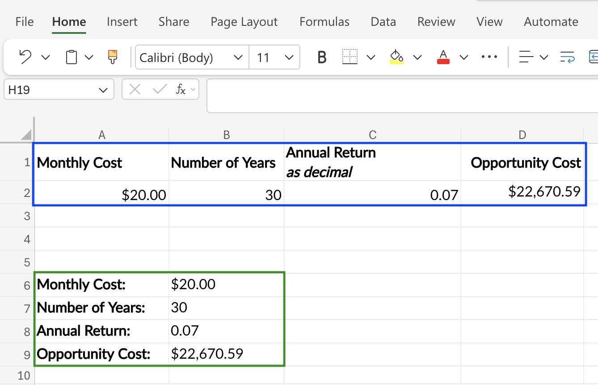

```{r}
#| label: setup-r
#| message: false
#| warning: false
#| include: false
source("_common.R")
```

```{python}
#| label: setup-py
#| include: false
import polars as pl
pl.Config.set_tbl_rows(20)

def fmt_dollar(x, digits=2):
    return f"${x:,.{digits}f}"

def fmt_pct(x, digits=1):
    return f"{x * 100:.{digits}f}%"
```

## Book Topics

- **Tracking vs. budgeting**: tracking records where money actually went; budgeting allocates where it should go; comparing the two creates a feedback loop
- **Capture methods**: spending journal, checkbook register, cash envelopes, bank statements; pick one and run it for a full month
- **Categorizing**: start with about 10 stable buckets (housing, transportation, groceries, dining out, subscriptions, personal, health, gifts, fun money, other); when in doubt use "Other", and only promote a new category after seeing it three months in a row
- **Using spreadsheets**: bank exports have `Date`, `Description`, and `Amount` columns; a keyword lookup adds the `Category` column in one pass
- **Monthly review**: pull, categorize, compare to budget, and pick *one* change for next month
- **Online subscriptions**: Americans spend about $219/month on subscriptions and underestimate it by $133; audit every quarter and cancel anything unused in 30 days
- **Math**: the subscription audit, the opportunity cost of a $20/month subscription invested at 7% for 30 years (about $22,700)

## Bank Statement Data

A minimal bank export has three columns: `Date`, `Description`, and `Amount`. The code blocks below show how to create an example bank statement file in R, Python, and Excel. 

::: panel-tabset

## R

```{r}
#| label: bank-statement-r
r_bank_statement <- tibble::tibble(
  Date = as.Date(c(
    "2026-01-02", "2026-01-02", "2026-01-03", "2026-01-03",
    "2026-01-04", "2026-01-04", "2026-01-05", "2026-01-06",
    "2026-01-07", "2026-01-08", "2026-01-09", "2026-01-10",
    "2026-01-11", "2026-01-12", "2026-01-13", "2026-01-14",
    "2026-01-15"
  )),
  Description = c(
    "Employer Payroll", "Rent", "Comcast Internet", "Trader Joe's",
    "Shell Gas", "Netflix", "Starbucks", "PG&E Electric",
    "AT&T Wireless", "Spotify", "Whole Foods", "Chipotle",
    "Geico Auto Insurance", "NYTimes Digital", "Shell Gas", "Costco",
    "24 Hour Fitness"
  ),
  Amount = c(
     2400.00, -1500.00, -75.00, -82.45, -45.20, -15.99, -6.75,
    -142.30, -85.00, -10.99, -64.12, -14.50, -125.00, -17.00,
     -42.80, -156.78, -39.99
  )
)

r_bank_statement |> knitr::kable()
```

We can view the bank statement in R using `knitr::kable()`.

## Python

In Python, we'll use `polars` to create a `DataFrame` and display the bank statement. This is similar to the `tibble` we created above. 

```{python}
#| label: bank-statement-py
import polars as pl

py_bank_statement = pl.DataFrame({
    "Date": [
        "2026-01-02", "2026-01-02", "2026-01-03", "2026-01-03",
        "2026-01-04", "2026-01-04", "2026-01-05", "2026-01-06",
        "2026-01-07", "2026-01-08", "2026-01-09", "2026-01-10",
        "2026-01-11", "2026-01-12", "2026-01-13", "2026-01-14",
        "2026-01-15"
    ],
    "Description": [
        "Employer Payroll", "Rent", "Comcast Internet", "Trader Joe's",
        "Shell Gas", "Netflix", "Starbucks", "PG&E Electric",
        "AT&T Wireless", "Spotify", "Whole Foods", "Chipotle",
        "Geico Auto Insurance", "NYTimes Digital", "Shell Gas", "Costco",
        "24 Hour Fitness"
    ],
    "Amount": [
         2400.00, -1500.00, -75.00, -82.45, -45.20, -15.99, -6.75,
        -142.30, -85.00, -10.99, -64.12, -14.50, -125.00, -17.00,
         -42.80, -156.78, -39.99
    ]
}).with_columns(pl.col("Date").str.to_date())

py_bank_statement
```

## Excel

We can simply copy and paste the data into Excel; `Date` in A, `Description` in B, `Amount` in C.

{width='75%' fig-align='center'}

:::

## Categorizing Transactions

Map description keywords to budget buckets in a single pass.

::: panel-tabset

## R

In R, we can use `dplyr` to do the following:

- `dplyr::case_when()` evaluates each pattern in order and assigns the matching category

  - `grepl()` does the keyword test against `Description`

- The final `TRUE` arm catches everything that didn't match and labels it `"Other"`
```{r}
#| label: categorize-r
r_bank_statement <- r_bank_statement |>
  dplyr::mutate(
    Category = dplyr::case_when(
      grepl("Payroll", Description) ~ "Income",
      grepl("Rent", Description) ~ "Housing",
      grepl("Comcast|PG&E|AT&T", Description) ~ "Utilities",
      grepl("Trader Joe|Whole Foods|Costco", Description) ~ "Groceries",
      grepl("Shell", Description) ~ "Transportation",
      grepl("Starbucks|Chipotle", Description) ~ "Dining",
      grepl("Netflix|Spotify|NYTimes|24 Hour Fitness", Description) ~ "Subscriptions",
      grepl("Geico", Description) ~ "Insurance",
      TRUE ~ "Other"
    )
  )

r_bank_statement |> 
  knitr::kable()
```

## Python

`polars` is similar to `dplyr`, but:

- `with_columns()` is the `mutate()` analog

  - a chain of `pl.when().then()` calls is the `case_when()` analog

- `pl.col("Description").str.contains(...)` does the keyword test

  - regex by default and the `|` between merchants is alternation

```{python}
#| label: categorize-py
py_bank_statement = py_bank_statement.with_columns(
    Category = pl.when(pl.col("Description").str.contains("Payroll")).then(pl.lit("Income"))
        .when(pl.col("Description").str.contains("Rent")).then(pl.lit("Housing"))
        .when(pl.col("Description").str.contains("Comcast|PG&E|AT&T")).then(pl.lit("Utilities"))
        .when(pl.col("Description").str.contains("Trader Joe|Whole Foods|Costco")).then(pl.lit("Groceries"))
        .when(pl.col("Description").str.contains("Shell")).then(pl.lit("Transportation"))
        .when(pl.col("Description").str.contains("Starbucks|Chipotle")).then(pl.lit("Dining"))
        .when(pl.col("Description").str.contains("Netflix|Spotify|NYTimes|24 Hour Fitness")).then(pl.lit("Subscriptions"))
        .when(pl.col("Description").str.contains("Geico")).then(pl.lit("Insurance"))
        .otherwise(pl.lit("Other"))
)

py_bank_statement
```

## Excel

In Excel, the [`IFS()` function](https://support.microsoft.com/en-US/Excel/IFS-function) is the direct analog of `case_when()`/`when().then()`. 

- `IFS()` takes a list of conditions and corresponding values, evaluated top to bottom, with the first match winning

- `SEARCH()` returns the position of a keyword in a cell (or `#VALUE!` if not found)

- Wrapping it in `ISNUMBER()` turns that into a true/false test

  - For categories with several rows/transactions, wrap the tests in `OR()`

- The final `TRUE, "Other"` arm is the equivalent of `dplyr`'s `TRUE ~ "Other"` and `polars`'s `.otherwise(...)`; it catches anything that didn't match an earlier pattern.

```swift
=IFS(
  ISNUMBER(SEARCH("Payroll",B2)), "Income",
  ISNUMBER(SEARCH("Rent",B2)), "Housing",
  OR(ISNUMBER(SEARCH("Comcast",B2)),ISNUMBER(SEARCH("PG&E",B2)),ISNUMBER(SEARCH("AT&T",B2))), "Utilities",
  OR(ISNUMBER(SEARCH("Trader Joe",B2)),ISNUMBER(SEARCH("Whole Foods",B2)),ISNUMBER(SEARCH("Costco",B2))), "Groceries",
  ISNUMBER(SEARCH("Shell",B2)), "Transportation",
  OR(ISNUMBER(SEARCH("Starbucks",B2)),ISNUMBER(SEARCH("Chipotle",B2))), "Dining",
  OR(ISNUMBER(SEARCH("Netflix",B2)),ISNUMBER(SEARCH("Spotify",B2)),ISNUMBER(SEARCH("NYTimes",B2)),ISNUMBER(SEARCH("24 Hour Fitness",B2))), "Subscriptions",
  ISNUMBER(SEARCH("Geico",B2)), "Insurance",
  TRUE, "Other"
)
```

If the statement is laid out with `Date` in column `A`, `Description` in column `B`, and `Amount` in column `C`, type `Category` in cell `D1`, then paste the formula below into `D2`:

{width='100%' fig-align='center'}

Then copy `D2` down through every transaction row (select `D2`, double-click the small square in the bottom-right corner, or use `Ctrl+D` after selecting `D2:D{last_row}`).

* To add a new merchant when one shows up: edit the formula in `D2`, then re-fill down. Keep the new merchant near the bottom of its category group so the existing patterns still resolve first.

In Excel, we can also use the *Format as Table* feature to make the data easier to read.[^excel-tables] You can select a color/style for your table and it will automatically update the data. 

{width='100%' fig-align='center'}

[^excel-tables]: Read the [Overview of Excel tables](https://support.microsoft.com/en-us/excel/overview-of-excel-tables) on the Microsoft documentation. 

:::

## Answering Tracking Questions

Once every row has a category, the book's three tracking questions take one short pipeline each: what did subscriptions cost, what share of income went to fixed costs, and which variable category was biggest?

::: panel-tabset

## R

Totals by category, spending only (negative amounts), largest first:

```{r}
#| label: category-totals-r
income <- sum(r_bank_statement$Amount[r_bank_statement$Amount > 0])

category_totals <- r_bank_statement |>
  dplyr::filter(Amount < 0) |>
  dplyr::group_by(Category) |>
  dplyr::summarise(Total = -sum(Amount), .groups = "drop") |>
  dplyr::arrange(dplyr::desc(Total)) |>
  dplyr::mutate(Share = fmt_pct(Total / income))

category_totals |> knitr::kable()
```

Total spent on subscriptions:

```{r}
#| label: subscription-total-r
category_totals$Total[category_totals$Category == "Subscriptions"] |> fmt_dollar()
```

Share of income going to fixed costs (housing, utilities, and insurance):

```{r}
#| label: fixed-share-r
fixed <- c("Housing", "Utilities", "Insurance")
fixed_total <- sum(category_totals$Total[category_totals$Category %in% fixed])
fmt_dollar(fixed_total)
fmt_pct(fixed_total / income)
```

The biggest variable category:

```{r}
#| label: biggest-variable-r
category_totals |>
  dplyr::filter(Category %nin% c(fixed, "Subscriptions")) |>
  dplyr::slice_max(Total, n = 1)
```

How to read this result: this statement covers only half a month and one \$2,400 paycheck, but the full month's rent. That is why fixed costs look like 80% of income. Always compare a full month of spending against a full month of income before drawing conclusions.

## Python

The same three answers with `polars`:

```{python}
#| label: category-totals-py
income = py_bank_statement.filter(pl.col("Amount") > 0)["Amount"].sum()

category_totals = (
    py_bank_statement
    .filter(pl.col("Amount") < 0)
    .group_by("Category")
    .agg((-pl.col("Amount").sum()).alias("Total"))
    .sort("Total", descending=True)
    .with_columns((pl.col("Total") / income).alias("Share"))
)

category_totals
```

Total spent on subscriptions:

```{python}
#| label: subscription-total-py
subs = category_totals.filter(pl.col("Category") == "Subscriptions")["Total"][0]
fmt_dollar(subs)
```

Share of income going to fixed costs:

```{python}
#| label: fixed-share-py
fixed = ["Housing", "Utilities", "Insurance"]
fixed_total = category_totals.filter(pl.col("Category").is_in(fixed))["Total"].sum()
print(fmt_dollar(fixed_total), fmt_pct(fixed_total / income))
```

The biggest variable category:

```{python}
#| label: biggest-variable-py
(
    category_totals
    .filter(~pl.col("Category").is_in(fixed + ["Subscriptions"]))
    .head(1)
)
```

## Excel

With `Date` in `A`, `Description` in `B`, `Amount` in `C`, and `Category` in `D`, the [`SUMIF()` function](https://support.microsoft.com/en-us/excel/sumif-function) adds up one category. Total spent on subscriptions:

```swift
=-SUMIF(D:D, "Subscriptions", C:C)
```

The minus sign turns the negative spending total into a positive number. Fixed costs as a share of income (format the cell as a percentage):

```swift
=-(SUMIF(D:D,"Housing",C:C)+SUMIF(D:D,"Utilities",C:C)+SUMIF(D:D,"Insurance",C:C))/SUMIF(C:C,">0")
```

For every category at once, select the data and use **Insert → PivotTable**, with `Category` in Rows and `Amount` in Values.

:::

## The Subscription Audit Math

A \$20/month subscription feels trivial. Cancel it and invest the \$240 a year instead, and the chart below shows what that money grows into at each checkpoint, split into the money you put in and the growth it earned.

**Formula:** Annual cost × ((1 + r)\^n − 1) ÷ r = Opportunity cost in *n* years

With the book's 7% real return (the return after inflation), *r* = 0.07.

```{r}
#| label: subscription-bar-model
#| echo: false
#| fig-cap: "$240 a year invested at 7% instead of a $20/month subscription"
#| fig-asp: 0.50
library(ggplot2)
years  <- c(1, 5, 10, 20, 30)
values <- 240 * ((1.07^years - 1) / 0.07)
put_in <- 240 * years
df_sub <- data.frame(
  year   = factor(rep(paste0("Year ", years), 2), levels = paste0("Year ", years)),
  layer  = factor(rep(c("Growth", "Money put in"), each = length(years)),
                  levels = c("Growth", "Money put in")),
  amount = c(values - put_in, put_in)
)
ggplot(df_sub, aes(x = year, y = amount, fill = layer)) +
  geom_col(width = 0.6, colour = "#1C1C1E", linewidth = 0.4) +
  geom_text(
    data = data.frame(year = factor(paste0("Year ", years), levels = paste0("Year ", years)),
                      total = values),
    aes(x = year, y = total, label = paste0("$", formatC(round(total), format = "d", big.mark = ","))),
    inherit.aes = FALSE, vjust = -0.4, fontface = "bold", size = 3.5, colour = "#1C1C1E"
  ) +
  scale_fill_manual(values = c("Money put in" = "#0e9aa7", "Growth" = "#f44242")) +
  scale_y_continuous(
    labels = function(x) paste0("$", formatC(x, format = "d", big.mark = ",")),
    expand = expansion(mult = c(0, 0.12))
  ) +
  labs(x = NULL, y = NULL, fill = NULL) +
  theme_minimal(base_size = 12) +
  theme(
    legend.position    = "top",
    panel.grid.major.x = element_blank(),
    panel.grid.minor   = element_blank()
  )
```

Each bar adds another year's \$240 to everything saved so far, and the whole pile grows by 7%. After 30 years you put in \$7,200, and growth added about \$15,500.

::: panel-tabset

## R

```{r}
#| label: subscription-opp-cost-r
subscription_opportunity_cost <- function(monthly_cost, years, rate = 0.07) {
  annual_cost <- monthly_cost * 12
  annual_cost * ((1 + rate)^years - 1) / rate
}
```

A \$20/month subscription for 30 years at 7%:

```{r}
#| label: subscription-opp-cost-r-apply
subscription_opportunity_cost(monthly_cost = 20, years = 30) |> fmt_dollar()
```

Sanity check: money put in vs. growth.

```{r}
#| label: subscription-opp-cost-r-check
oc <- subscription_opportunity_cost(20, 30)
put_in <- 20 * 12 * 30
c(put_in = put_in, growth = round(oc - put_in))
```

Now audit the four subscriptions in the bank statement above. The function is vectorized, so one call prices them all:

```{r}
#| label: subscription-audit-r
subs <- r_bank_statement |>
  dplyr::filter(Category == "Subscriptions") |>
  dplyr::transmute(Description, monthly = -Amount)

subs$after_10 <- round(subscription_opportunity_cost(subs$monthly, 10))
subs$after_30 <- round(subscription_opportunity_cost(subs$monthly, 30))
subs |> knitr::kable()
fmt_dollar(sum(subs$after_30))
```

How to read this result: the \$83.97 a month in this statement is a \$95,000 decision over 30 years. The gym membership alone is nearly half of it.

The book's survey figure of \$219/month uses monthly deposits. The audit formula above uses yearly deposits, which comes out a little lower:

```{r}
#| label: subscription-survey-r
# yearly deposits (the audit formula)
subscription_opportunity_cost(219, 30) |> fmt_dollar()
# monthly deposits (the book's ~$267,000)
(219 * ((1 + 0.07 / 12)^(30 * 12) - 1) / (0.07 / 12)) |> fmt_dollar()
```

Edge case: a rate of 0 divides by zero and returns `NaN`. With no growth, the opportunity cost is just the money you would have spent.

```{r}
#| label: subscription-opp-cost-r-edge
subscription_opportunity_cost(20, 30, rate = 0)
20 * 12 * 30
```

## Python

```{python}
#| label: subscription-opp-cost-py
def subscription_opportunity_cost(monthly_cost, years, rate=0.07):
    annual_cost = monthly_cost * 12
    return annual_cost * ((1 + rate) ** years - 1) / rate
```

A \$20/month subscription for 30 years at 7%:

```{python}
#| label: subscription-opp-cost-py-apply
fmt_dollar(subscription_opportunity_cost(monthly_cost=20, years=30))
```

Sanity check: money put in vs. growth.

```{python}
#| label: subscription-opp-cost-py-check
oc = subscription_opportunity_cost(20, 30)
put_in = 20 * 12 * 30
print(fmt_dollar(put_in, 0), fmt_dollar(oc - put_in, 0))
```

Audit the four subscriptions in the bank statement. `polars` expressions are vectorized, so the formula runs on every row:

```{python}
#| label: subscription-audit-py
subs = (
    py_bank_statement
    .filter(pl.col("Category") == "Subscriptions")
    .select("Description", (-pl.col("Amount")).alias("monthly"))
    .with_columns(
        subscription_opportunity_cost(pl.col("monthly"), 10).round(0).alias("after_10"),
        subscription_opportunity_cost(pl.col("monthly"), 30).round(0).alias("after_30"),
    )
)
subs
```

```{python}
#| label: subscription-audit-py-total
fmt_dollar(subs["after_30"].sum())
```

The survey's \$219/month with yearly deposits vs. monthly deposits:

```{python}
#| label: subscription-survey-py
monthly_rate = 0.07 / 12
print(fmt_dollar(subscription_opportunity_cost(219, 30)))
print(fmt_dollar(219 * ((1 + monthly_rate) ** 360 - 1) / monthly_rate))
```

Edge case: a rate of 0 raises a `ZeroDivisionError` in Python, so fall back to the money you would have spent:

```{python}
#| label: subscription-opp-cost-py-edge
try:
    subscription_opportunity_cost(20, 30, rate=0)
except ZeroDivisionError:
    print("No growth:", fmt_dollar(20 * 12 * 30))
```

## Excel

In Excel, create a new sheet with the inputs:

| Monthly cost | Number of Years | Annual Return (as decimal) | Opportunity Cost |
| ------------ | --------------- | -------------------------- | ---------------- |
| $20          | 30              | 0.07                       | *Formula below*  |

The formula (given this setup) in `D2`:

```swift
=(A2*12)*((1+C2)^B2-1)/C2
```

`A2*12` converts the monthly cost to annual; the rest is the future value formula for regular deposits, using the rate in `C2` and the time horizon in `B2`.

{width='100%' fig-align='center'}

`FV()` gives the same answer, \$22,670.59:

```swift
=FV(C2, B2, -A2*12)
```

To audit several subscriptions, list each monthly cost in `A2:A5` (15.99, 10.99, 17.00, 39.99), keep the years and rate in `B` and `C`, fill `D2` down, and total them with `=SUM(D2:D5)`.

If the data is arranged differently, adjust the cell references accordingly:

{width='100%' fig-align='center'}

{width='100%' fig-align='center'}

:::
